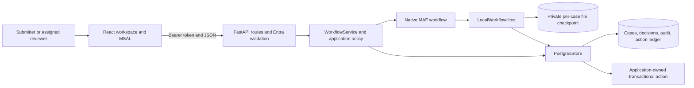
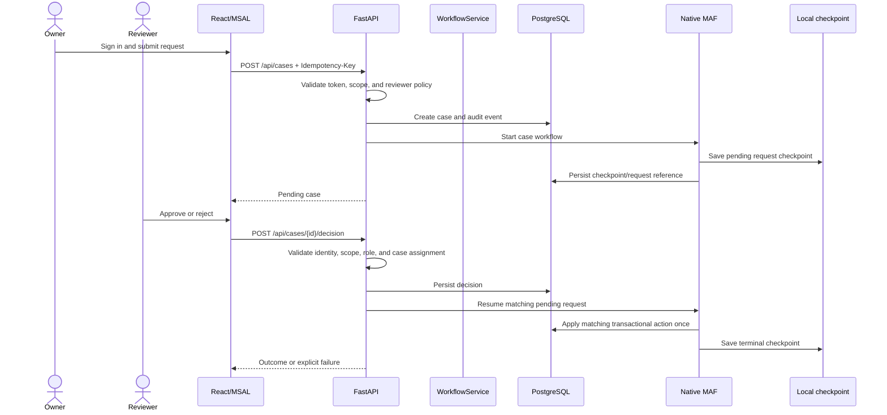

# Architecture

## Purpose and status

This is the source map for the local MAF workflow blueprint. The implemented
topology is React/MSAL, FastAPI, a native MAF workflow, PostgreSQL, private
local file checkpoints, and Docker Compose. The synthetic application is an
explicit example. Foundry hosting, cloud telemetry, and Azure deployment are
planned and unverified. CI or local tests do not prove a live deployment.

## Component view

The browser is not authoritative for identity or permission. FastAPI validates
the token and derives the principal; application policy controls record access
and decisions. Workflow checkpoints preserve framework continuation state;
PostgreSQL owns business records, decision/audit history, and the action
ledger. These stores are separate and do not share an atomic transaction.

## Decision and persistence sequence

The per-case PostgreSQL advisory lock serializes host operations across
checkpoint and SQL transitions. It does not make checkpoint writes atomic with
database commits; startup recovery reconciles durable records and checkpoints.
The same-transaction action ledger applies only to database effects performed
through the supplied transaction. External side effects require downstream
idempotency or a transactional outbox.

## Trust and extension boundaries

- `ApplicationComponents` supplies application-owned business rules, access
  policy, transactional action, optional initialization, and optionally a
  workflow factory.
- `StateRepository` and `WorkflowHost` are narrow domain boundaries. Replacing
  either requires preserving identity isolation, decision ordering,
  idempotency, recovery, and failure semantics.
- MAF input and application payloads are untrusted. A model/tool response is
  not authorization; no model recommendation can approve an action.
- Entra identities are validated by the API. Test providers and signing keys
  are not runtime authentication modes.
- Optional OBO is server-side, explicitly configured and scope-allowlisted;
  the included synthetic application makes no downstream call.
- Logs and correlation identifiers are potentially sensitive. Do not record
  bearer tokens, authorization codes, secrets, or payloads.

## Hosting boundary

`LocalWorkflowHost` constructs per-case `FileCheckpointStorage` under a
private single-host directory. PostgreSQL is not a checkpoint store. A future
Foundry host must use its supported host-managed checkpoint provider and a
request-aware factory; it must not attach the local provider as a second
checkpoint authority. ACA would require its own selected and verified
multi-replica-safe strategy. Neither hosting path is implemented here.

For code responsibilities, see [project structure](projectstructure.md); for
service and operator guidance, see the [project guide](../architecture.md).
