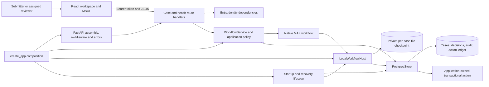
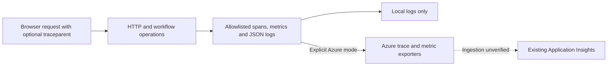
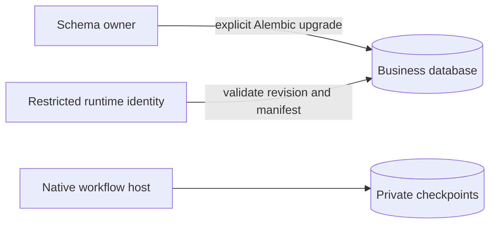
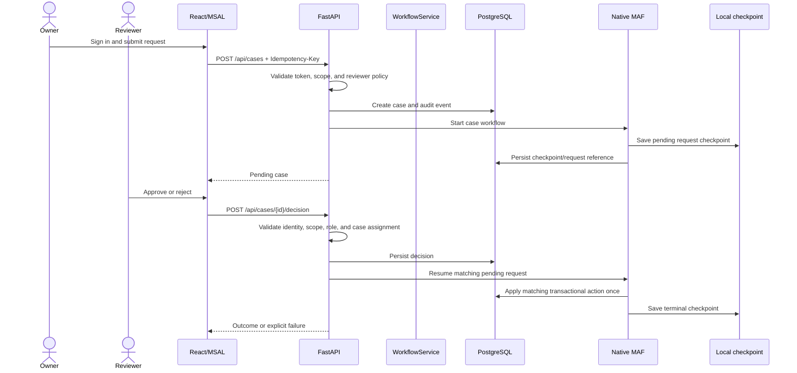
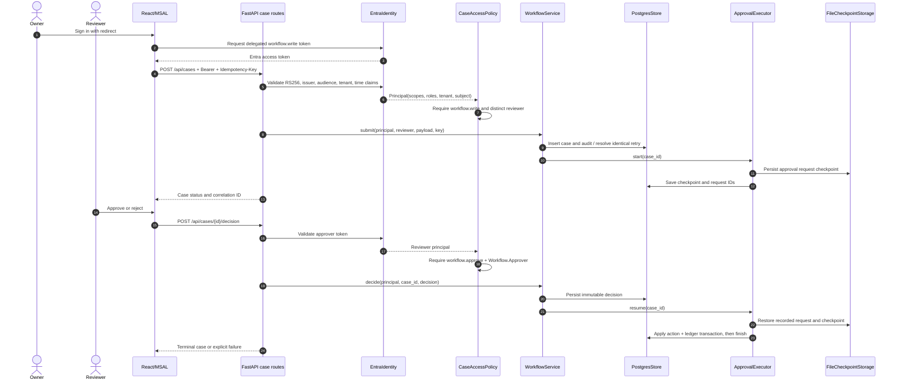
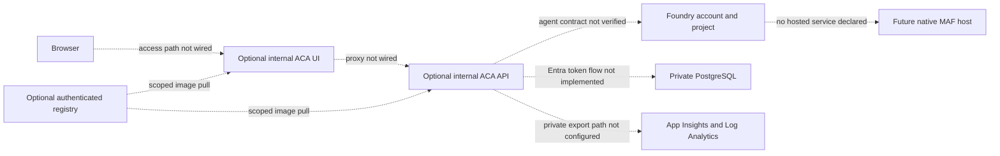

# Architecture

## Purpose and status

This is the source map for the local MAF workflow blueprint. The implemented
topology is React/MSAL, FastAPI, a native MAF workflow, PostgreSQL, private
local file checkpoints, and Docker Compose. The synthetic application is an
explicit example. Manual telemetry and opt-in Azure exporters are implemented;
hosted ingestion, Foundry hosting, and Azure deployment remain unverified.
Staged Bicep/azd definitions and offline checks exist, but CI or local tests
do not prove a live deployment.

The structure follows the reference project's useful documentation pattern of
separating logical responsibilities, process interactions, development/source
ownership, physical boundaries, and end-to-end scenarios. This blueprint uses
those viewpoints to describe its own current code; it does not adopt the
reference project's order-resolution domain, hosted paths, or claims.

## Component view

## Telemetry boundary

Only allowlisted operation/outcome dimensions are recorded in metrics, with
no exemplars. Identifiers, payloads and exception details are excluded from
telemetry; static device and instance values prevent host-name fallback.
No collector is provisioned. Export failures are sanitized and do not alter
workflow outcomes; configuration or initialization failures stop startup.
Instrumented work is not retried when span setup, annotation or closure
fails. SDK failures emit a sanitized signal and cannot replace an application
exception. If operational logging fails, a fixed failure event is written to
stderr without exception text or payload; stderr failure also cannot change
application behavior. Startup failure cleanup includes initialized exporters
and pre-lifespan service initialization.

This manual telemetry behavior does not establish that native global
auto-instrumentation is privacy-safe. The PR #14 owner reports an opt-in probe
on the pinned stack emitted duplicate FastAPI spans
(`fastapi.dependencies`, `fastapi.endpoint`, `fastapi.serialization`, and
`GET /secret`) alongside manual HTTP telemetry and leaked a synthetic query
canary into exported span JSON. The integrated fix from `3aa389f` removes the
opt-in and disables auto-instrumentation; all 23 focused telemetry regressions
passed locally, including recovery redaction and restricted-origin CORS.
Public metric APIs replace private SDK fields. Exact PR #17 head
`8b3c3578f36c30f32f4539ef1d181e1ff3984ab4`, based on
`1e99e038dc31c0ae25e5ea7712030d204ee35bc0`, passed all six jobs in run
`44960731511`; its merge ref `2ab8f3c92ebde95aa5c0bfb2cd33b0e5ab558c52`
had the exact base/head parents and identical tree. Cloud ingestion remains
unverified and native auto-instrumentation is not approved. Any later tree or
base change also requires revalidation.
Track safe cloud export and end-to-end propagation separately in
[#26](https://github.com/ppenumatsa1/agent-blueprints/issues/26).

The browser is not authoritative for identity or permission. FastAPI validates
the bearer token and derives the principal; `CaseAccessPolicy` controls record
access and decisions. `composition.py` wires the repository, identity provider, host, service, and
lifespan. `api/app.py` assembles FastAPI and installs CORS, middleware,
exception handlers, and routers; route handlers, schemas, and dependencies
are separate modules under `api/`. `lifecycle.py` owns startup initialization
and recovery. These are canonical direct-import modules; no forwarding
`app.api` shim remains.

Workflow checkpoints preserve framework continuation state; PostgreSQL owns
business records, decision/audit history, and the action ledger. These stores
are separate and do not share an atomic transaction. The per-case session
advisory lock serializes host activity; it is not a distributed checkpoint
transaction.

## Schema ownership

Migration uses transaction-scoped exclusive locking and checks both the
incoming revision and resulting head; runtime validation uses a shared lock
and does not create schema objects. The locks do not quiesce application
writers or manual DDL. Local PostgreSQL 16.15 and 17.12 tests exercise a
second revision; live restore and managed database behavior are unverified.

## Decision and persistence sequence

The per-case PostgreSQL advisory lock serializes host operations across
checkpoint and SQL transitions. It does not make checkpoint writes atomic with
database commits; startup recovery reconciles durable records and checkpoints.
The same-transaction action ledger applies only to database effects performed
through the supplied transaction. Consequential external side effects require
service-specific authorization, verified downstream idempotency and
authoritative reconciliation; otherwise fail closed and use manual resolution
instead of retrying an ambiguous effect. A transactional outbox only persists
intent; it cannot deduplicate an external effect after a lost acknowledgment.
Their authorization and retry/idempotency boundary is tracked in
[#32](https://github.com/ppenumatsa1/agent-blueprints/issues/32).
Consequential remote actions are blocked until the P0 authorization,
idempotency, and reconciliation requirements are verified.

For an interrupted start, the local host asks the MAF file provider for the
latest checkpoint after validating every file; the provider accounts for
lineage when timestamps tie. After running a workflow, the host uses that
workflow instance's last persisted checkpoint instead of sorting by wall
clock time. It checks the pending request before recording it and requires a
terminal checkpoint with no pending requests or queued messages before
marking execution complete or accepting a completed replay. A missing or
incomplete checkpoint remains an explicit recovery error; a committed
database action is protected by the action ledger on retry.

## Process and lifecycle view

The real request path has three API operations; it does not expose a chat,
SSE, or hosted Responses contract:

### Startup and recovery sequence

`backend/app/main.py` reads and validates configuration, resolves the
`BLUEPRINT_APPLICATION` factory, and calls `create_app()` in
`backend/app/composition.py`. That function wires the repository, identity,
host, service, and `create_lifespan()` before delegating API assembly to
`create_api_app()` in `backend/app/api/app.py`. A schema owner runs the
explicit Alembic upgrade before runtime startup. The lifespan validates the
expected revision without DDL, calls the application's initializer, and
walks incomplete cases returned by
`PostgresStore.recoverable()` in creation order. `created` cases use
`LocalWorkflowHost.start`; approved/rejected/completed-but-not-terminal cases
use `resume`. Per-case PostgreSQL advisory locks serialize overlapping
workers. Recovery conflicts are warnings; action failures and blueprint
errors are logged with a safe case identifier and error class, and
blueprint errors record a recovery failure code. This is one-process startup
recovery, not a multi-region or hosted recovery guarantee.

### API and response contract

| Route | Request / response | Success / failure boundary |
| --- | --- | --- |
| `GET /healthz` | No body | `204`; liveness only and unauthenticated |
| `POST /api/cases` | `{ reviewer_id: UUID, payload: object }`, `Idempotency-Key`; returns `CaseOutput` | `200`; `401`, `403`, `409`, `422`, `503` as applicable |
| `GET /api/cases/{case_id}` | UUID; returns authorized `CaseOutput` | `200`; `401`, `403`, `404` |
| `POST /api/cases/{case_id}/decision` | `{ decision: approved|rejected }`; returns `CaseOutput` | `200`; `401`, `403`, `404`, `409`, `503` |

`CaseOutput` includes `id`, `correlation_id` (currently the same UUID as the
case ID), status, decision, payload, `execution_complete`, and failure code.
The middleware separately generates `X-Correlation-ID` per HTTP request. A
generic 500 body and exception-class-only logging prevent exception details
from becoming API output. The code does not include distributed trace context
propagation or a telemetry exporter.

## Trust and extension boundaries

- `ApplicationComponents` supplies application-owned business rules, access
  policy, transactional action, optional initialization, and optionally a
  workflow factory. `app/extensions/` defines typed provider selection,
  versioned prompt assets, native MAF `Agent` construction, and an
  authorization-aware MAF tool registry. Provider factories, policy, and
  tools remain application-owned; the generated synthetic fixture tests
  construction and denial paths without calling a model.
- `WorkflowFactory` retains its native MAF `Executor`/`WorkflowBuilder`
  signature and passes host-owned checkpoint storage through unchanged.
  Preserve workflow/executor identity, pending request and response
  semantics, and host checkpoint ownership; the local native workflow test
  does not verify Foundry hosting or recovery.
- `StateRepository` and `WorkflowHost` are narrow domain boundaries. Replacing
  either requires preserving identity isolation, decision ordering,
  idempotency, recovery, and failure semantics.
- MAF input and application payloads are untrusted. A model/tool response is
  not authorization; no model recommendation can approve an action.
- Tool factories bind a trusted principal per request, and handlers must
  authorize again at invocation using application policy and the supplied
  resource identifier. This read-only synthetic tool is not evidence of
  external-effect authorization, idempotency, or human approval.
- Entra identities are validated by the API. Test providers and signing keys
  are not runtime authentication modes.
- Optional OBO is server-side, explicitly configured and scope-allowlisted;
  the included synthetic application makes no downstream call.
- Logs and correlation identifiers are potentially sensitive. Do not record
  bearer tokens, authorization codes, secrets, or payloads.

## Hosting boundary

`LocalWorkflowHost` constructs per-case `FileCheckpointStorage` under a
private single-host directory. PostgreSQL is not a checkpoint store. A future
Foundry host must use its supported host-managed checkpoint provider and a
request-aware factory; it must not attach the local provider as a second
checkpoint authority. ACA would require its own selected and verified
multi-replica-safe strategy. Neither hosting path is implemented here.
Foundry hosting/checkpoints, caller binding and lost-response recovery remain
tracked separately in [#19](https://github.com/ppenumatsa1/agent-blueprints/issues/19),
[#22](https://github.com/ppenumatsa1/agent-blueprints/issues/22), and
[#20](https://github.com/ppenumatsa1/agent-blueprints/issues/20). Recovery
was explicitly deferred to a scoped follow-up, not waived. Do not introduce a
custom checkpoint provider without a demonstrated requirement and independent
recovery evidence.

## Staged Foundry-first infrastructure

The optional model, project-wide API agent-consumer grant, registry and
Container Apps default off. Foundry public
access and monitoring public ingestion/query are disabled, but this increment
does not provide their private endpoints or verify any runtime connection.
PostgreSQL uses a delegated subnet, private DNS and Entra-only authentication;
the existing API does not acquire a database token. The staged server selects
PostgreSQL 16, whereas local Compose uses 17. The PR #16 migration owner
reports 12 focused migration tests on isolated PostgreSQL 17 and a five-job
Actions pass on merge commit
`d1251352835c2d02e91690104b4dcabf465f5f05` (run 44947337144). This is
PR #16-specific evidence, not combined PR #17 or Azure compatibility evidence.
Container Apps platform
auth is a separately applied resource; application-level authentication and
record authorization remain mandatory even if it fails. The optional registry
is publicly network-reachable but disallows anonymous and admin access.
The eventual agent-scoped caller binding and inherited role assignments still
need review; no endpoint caller exclusivity is established. ACA internal
ingress is environment-scoped, so the UI is not directly reachable by a
browser elsewhere on the VNet.
See the [infrastructure guide](../../infra/README.md) for all limitations.
Track static graph wiring in
[#18](https://github.com/ppenumatsa1/agent-blueprints/issues/18), managed
PostgreSQL operations in [#24](https://github.com/ppenumatsa1/agent-blueprints/issues/24),
the separately authorized deployment in
[#28](https://github.com/ppenumatsa1/agent-blueprints/issues/28), and the
optional ACA workflow alternative in
[#31](https://github.com/ppenumatsa1/agent-blueprints/issues/31).

## Hosted Responses, identity, credentials and recovery

The PR #15 workstream owner reports the documented native Python Responses
pattern uses `ResponsesServerOptions(resilient_background=True)` with Requests
`store=true, background=true`. The host owns durable workflow checkpoints;
do not configure an independent checkpoint store for that Workflow.
Application-owned PostgreSQL remains separate from host-managed workflow
state. This is an upstream-supported design direction, not code in this
blueprint: there is no Responses host/dependency/agent service, and
package/API compatibility, workload networking, and hosted application
lifecycle require review and live verification before claiming hosted
durability. See Microsoft's
[Responses-protocol guidance](https://learn.microsoft.com/agent-framework/hosting/foundry-hosted-agent#responses-protocol).

For hosted caller binding, the proposed direction is for the authenticated
API to authorize the user and send Foundry workload Authorization together
with an opaque app-supplied `x-ms-user-identity` scoping value derived from
the validated principal. The hosted container receives platform-injected
`x-agent-user-id`; protocol 2.0.0 exposes that
platform-generated global per-user identifier through
`get_request_context().user_id`. This is a different header from the
app-supplied opaque `x-ms-user-identity`; do not assume their raw values match.
Their equivalence or binding to the validated application principal is unsupported
and unverified. The bridge must verify an explicit mapping to that principal
and authorize each principal's session. The caller needs Foundry Agent Consumer
and custom `UserIdentityImpersonation/action` authorization.
This avoids forwarding or persisting an end-user bearer/OBO token when the
hosted workflow does not need to call a downstream API as that user. The
bridge, role assignment, and network path remain unimplemented and unverified.
See the
[hosted-agent contract](https://learn.microsoft.com/azure/foundry/agents/concepts/hosted-agent-contract)
and [on-behalf-of guidance](https://learn.microsoft.com/azure/foundry/agents/how-to/use-on-behalf-of-flow).

Microsoft's
[per-user isolation guidance](https://learn.microsoft.com/azure/foundry/agents/how-to/isolate-sessions-per-user)
warns that delegated users are not fenced from one another within delegated
access: a user can access another user's data if the application routes them
to the same session. Therefore, a trusted application must authenticate each
caller, enforce a server-side caller-to-session mapping, assign distinct
session IDs, and reject unchecked client-supplied session IDs. The opaque
`x-ms-user-identity` value is an identity-scoping input, not authorization.
This blueprint has no hosted session bridge or mapping test, so per-user
hosted isolation is not implemented or verified.

The opaque scoping value is not a credential or authorization. Do not persist
an end-user bearer/OBO token in business state, workflow checkpoints, or logs.
The current local OBO option reads its secret from the backend environment;
there is no hosted secret delivery/rotation, workload-identity configuration,
or delegated-token lifecycle in this blueprint. If a hosted workflow must call
a downstream API as the user, its OBO acquisition, renewal, and credential
handling require a separately designed and verified path.

Hosted response recovery remains unresolved: polling requires `response.id`,
but response creation has no documented idempotency key. A matching
response-metadata record visible while paging by conversation can provide its
ID as best-effort correlation; an empty list has no documented bounded
read-after-write visibility and cannot prove that create failed. Conversation
creation has the same lost-ack ambiguity, and a per-operation lock cannot
make the remote create atomic with the application database. The local
database idempotency ledger cannot recover a hosted response identity. Do not
silently retry an ambiguous hosted request.

The AgentServer
[long-running API reference](https://learn.microsoft.com/azure/foundry/agents/concepts/long-running-agent-reference)
documents one-shot resilient tasks with durable task IDs, a possible
business-operation recovery building block. The PR #15 owner reports local
testing where completed one-shot task IDs ran fresh again, so this alone is
not persistent completed-result deduplication. It does not establish
idempotency for the outer Responses create call or hosted behavior. Task
namespace, different-input behavior, completed-result retention and reuse,
cross-session storage, authorization association, and recovery of external
effects remain unverified; this candidate does not unblock hosted retries.

The PR #15 owner also inspected
`agent-framework-foundry-hosting==1.0.0b261112`
(public PyPI wheel SHA-256
`9609ca758dd7f9e45542e2407b473acb7514ec6c0fd4dad3189068fd4ee2e55c`):
`HostedResponseRequest.response_id` is exposed in `_request.py:150-164`, and
`_workflow_responses.py:425-434` resolves the request-aware factory before
checkpoint preparation, parsing, and run claim. The parser is skipped on
recovery while the factory still runs. This establishes hook availability in
that exact source version only; safe caller binding, a separately linked
reservation for each continuation, pending-reply/action ordering, idempotent
side effects, same-response recovery, and hosted behavior remain unverified.

Configuration is deliberately local-only: `Settings` validates tenant/API
UUIDs, a PostgreSQL URL, explicit CORS origins, and optional OBO allowlisted
scopes, then rejects `WORKFLOW_HOST` values other than `local`. Compose
requires the application factory, API and SPA client IDs, tenant, API
application URI, and URL-safe PostgreSQL password. Vite embeds only the
non-secret SPA values at build time. The OBO secret remains in the backend
environment and the example does not call downstream services. There is no
Foundry endpoint, Responses request parser, host-managed checkpoint client,
or hosted caller-identity bridge. Bicep and azd assets are staged for static
validation only; they do not represent provisioned resources or verified
Azure identity, networking, or runtime behavior.
For code responsibilities, see [project structure](projectstructure.md); for
service and operator guidance, see the [project guide](../architecture.md).
