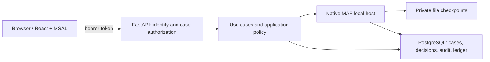

# Architecture

## Current local prototype

The application selects its own components. File checkpoints and database
transactions are distinct and require reconciliation; conversation state and
human authorization are also distinct. The web port is loopback-only in
Compose, while the API and database are not published. More detail and
extension recipes are in [architecture and extensions](../architecture.md).

## Planned hosting boundary

Foundry-hosted native workflow with host-managed checkpoints is a preferred
future target, not an implemented or verified path. An ACA-hosted workflow is
a separately assessed alternative, not a presumed equivalent store. Protect
public endpoints and verify hosting, identity, checkpoint and recovery
compatibility before any deployment. See [deployment flow](deployment-flow.md).
