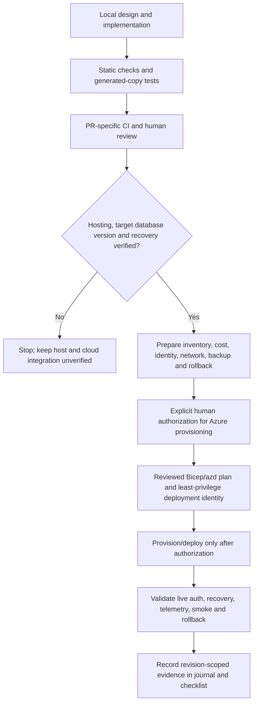

# Deployment and validation flow

## Status boundary

**Implemented:** local development, Docker Compose, source tests, generated
project tests, staged Bicep/azd definitions and credential-free static checks.
GitHub Actions contains source and generated-infrastructure jobs; the actual
PR-head run remains a separate acceptance gate.

**Planned and unverified:** azd provisioning/deployment, Foundry-hosted MAF,
managed identity binding, Azure resource validation, cloud telemetry, an ACA
workflow alternative, and live sign-in. This document describes
acceptance gates for future work; it does not provide or authorize a cloud
deployment command.

## Local development and Compose

1. Install Python 3.12, Node 22, Docker with Compose, and an isolated
   PostgreSQL database for direct tests. Use authorized existing Entra
   registrations for interactive sign-in; registration and consent are not
   created by the project.
2. Install backend requirements from `backend/requirements-dev.txt` and run
   the targeted source suite from `backend`:

   ```text
   python -m unittest -v tests.test_core tests.test_security tests.test_evidence_runner
   ```

3. From `frontend`, run `npm ci`, `npm test`, `npm run build`, and
   `npm run check-csp`.
4. From the project root, supply required environment variables and run
   `docker compose up --build --wait`. Only the UI binds to loopback. Review
   [setup](../setup.md) for secret handling and persistent-volume behavior.
5. Stop with `docker compose down`; volumes persist. Back up or delete data
   only under the operator's policy.

## CI and independent generation

`.github/workflows/ci.yml` (source repository) runs contract/readiness tests,
PostgreSQL-backed backend tests, frontend tests/build/CSP checks, Compose HTTP
and permission checks, static infrastructure checks, and `maf-independent`.
The independent job creates the
project outside the checkout, checks its own imports and build contexts, runs
generated infrastructure/backend/frontend/verification tests, validates evidence
disclosures, and builds the generated Compose stack. CI does not provision
Azure or prove live Entra/Foundry behavior. The generated-verifier pipeline
propagates the test command's nonzero exit through `tee` and separately
rejects skipped or expected-failure results; `tests/test_ci_workflow.py`
exercises these failure paths against the actual CI step.

From either the source blueprint or generated project root, with Python 3.12
and Bicep 0.49.2 or newer installed:

```text
python infra/validate.py
python -m unittest discover -s infra/tests -v
```

These compile and lint local modules, check synthetic parameter examples and
local azd paths, and inspect compiled security properties. They cannot validate
arbitrary future parameters or live Azure behavior. See
[infrastructure preparation](../../infra/README.md).

The staged server selects PostgreSQL 16 while Compose uses 17. A separate
migration revision passed 12 tests on local PostgreSQL 16.15, including
fresh, upgrade and drift cases; its initial auxiliary locale probe failed and
was corrected. Bicep compilation and local tests do not verify Azure
compatibility. Resolve the [version gap](../../infra/README.md#open-postgresql-version-gap)
and repeat migration tests on the exact integrated revision and selected
target before deployment; no automatic downgrade or cross-major data
compatibility is assumed.

Before PR approval:

1. Generate a fresh project outside the repository and verify all documentation,
   contract bytes, and imports are independent.
2. Run focused regression, security, durability, and independent checks
   affected by the change; the mandated contract-change command is
   `python -m unittest discover -s tests -v` in an isolated environment with
   `requirements-dev.txt` installed.
3. Confirm all required GitHub Actions checks belong to the exact PR head
   revision. A prior commit's green run is not evidence for a new revision.
4. Review the diff for compatibility shims, duplicate implementations,
   unused dependencies, stale paths, secrets, and unverified claims.

## Future Azure delivery gates



The checked-in modules and `azure.yaml` are staged definitions, not a supported
deployment path. Foundry and monitoring lack private endpoints; PostgreSQL
Entra token authentication and the API/UI/host bindings are not implemented.
Review scoped identity and network access, image provenance, cost and teardown
ownership, and live behavior before requesting authorization. Foundry's
host-managed checkpoint strategy and an ACA-compatible strategy are distinct;
neither may silently fall back to local file checkpoints. A public endpoint
must remain authenticated and authorized.

See [deployment design](../deployment.md) for the current prototype boundary
and [journal](issues-changes-fixes.md) for evidence and outstanding work.
