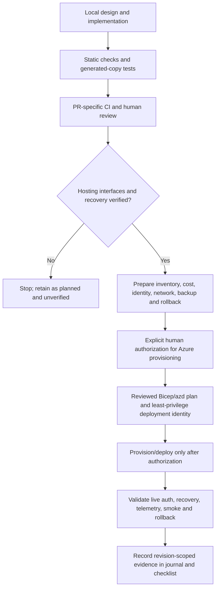

# Deployment and validation flow

## Status boundary

**Implemented:** local development, Docker Compose, source tests, generated
project tests, and GitHub Actions on GitHub-hosted runners.

**Planned and unverified:** Bicep infrastructure, azd provisioning/deployment,
Foundry-hosted MAF, managed identity binding, Azure resource validation, cloud
telemetry, ACA alternative, and live sign-in. This document describes
acceptance gates for future work; it does not provide or authorize a cloud
deployment command.

## Local development and Compose

1. Install Python 3.12, Node 22, Docker with Compose, and an isolated
   PostgreSQL database for direct tests. Use authorized existing Entra
   registrations for interactive sign-in; registration and consent are not
   created by the project.
2. Install backend requirements from `backend/requirements-dev.txt` and run
   the targeted source suite from `backend`:

   ```text
   python -m unittest -v tests.test_core tests.test_security tests.test_evidence_runner
   ```

3. From `frontend`, run `npm ci`, `npm test`, `npm run build`, and
   `npm run check-csp`.
4. From the project root, supply required environment variables and run
   `docker compose up --build --wait`. Only the UI binds to loopback. Review
   [setup](../setup.md) for secret handling and persistent-volume behavior.
5. Stop with `docker compose down`; volumes persist. Back up or delete data
   only under the operator's policy.

### Compose configuration and startup

Compose requires `POSTGRES_PASSWORD`, `BLUEPRINT_APPLICATION`,
`ENTRA_TENANT_ID`, `ENTRA_API_CLIENT_ID`, `ENTRA_SPA_CLIENT_ID`, and
`ENTRA_API_APP_ID_URI`. Optional `BLUEPRINT_PORT` defaults to `8080`;
`NPM_REGISTRY` and `PYTHON_PACKAGE_INDEX` default to the public registries.
`OBO_ENABLED` defaults to `false`; enabling it also requires
`ENTRA_API_CLIENT_SECRET` and resource-qualified `OBO_ALLOWED_SCOPES`.
Never put credentials in the Vite `VITE_*` build arguments; they are public
browser configuration. Full purpose and sensitivity descriptions are in
[setup](../setup.md).

`compose.yaml` starts PostgreSQL 17 and waits for its readiness probe before
starting the API. API startup reads settings, initializes the current
`schema.sql`, initializes the selected application factory, then attempts
recovery of recoverable cases before its health check succeeds. The web
container waits for API health and is the only published service; its port is
bound to `127.0.0.1`. Named volumes retain PostgreSQL data and local file
checkpoints across `docker compose down`.

```mermaid
sequenceDiagram
    participant Operator
    participant Compose
    participant DB as PostgreSQL 17
    participant API as FastAPI + local MAF
    participant Web as React web container
    Operator->>Compose: up --build --wait with required environment
    Compose->>DB: Start; wait for pg_isready
    Compose->>API: Start with DB URL and private checkpoint volume
    API->>DB: Initialize current schema.sql
    API->>API: Build application components
    API->>DB: Enumerate recoverable cases
    API->>API: Reconcile local checkpoints under case lock
    Compose->>Web: Build with public Vite Entra settings
    Compose->>Web: Start after API /healthz succeeds
    Operator->>Web: Browse on loopback HTTP
```

Schema initialization uses `CREATE TABLE IF NOT EXISTS`, not versioned
migrations; it is not an upgrade path for arbitrary existing schemas. Local
recovery is single-host and uses the persistent file-checkpoint volume. Do not
copy this topology to a hosted runtime: Foundry-managed checkpoint recovery,
caller binding, and lost-response handling remain unresolved.
Versioned migration support is proposed separately in
[PR #16](https://github.com/ppenumatsa1/agent-blueprints/pull/16); its
legacy-adoption and upgrade checks have not been reconciled onto this baseline
or verified against the current foundation.

## CI and independent generation

The source `.github/workflows/ci.yml` has five jobs: `contracts`,
PostgreSQL-backed `maf-core`, `maf-frontend` tests/build/CSP, `maf-compose`
HTTP/permission checks, and `maf-independent`. The independent job generates
outside the checkout, installs generated dependencies, runs backend/frontend
and verification tests, validates synthetic evidence disclosures, builds the
generated Compose stack, then removes its services. Its verifier step
propagates test failures through `tee` and rejects skipped or expected-failure
results; `tests/test_ci_workflow.py` exercises these paths against the actual
workflow step. CI does not provision Azure or prove live Entra/Foundry
behavior.

Before PR approval:

1. Generate a fresh project outside the repository and verify all documentation,
   contract bytes, and imports are independent.
2. Run focused regression, security, durability, and independent checks
   affected by the change; the mandated contract-change command is
   `python -m unittest discover -s tests -v` in an isolated environment with
   `requirements-dev.txt` installed.
3. Confirm all required GitHub Actions checks belong to the exact PR head
   revision. A prior commit's green run is not evidence for a new revision.
4. Review the diff for compatibility shims, duplicate implementations,
   unused dependencies, stale paths, secrets, and unverified claims.

## Future Azure delivery gates



No checked-in Bicep modules or `azure.yaml` deployment path is currently
provided for this blueprint. A future Bicep/azd change must add credential-free
CI validation, scoped identity and network review, cost and teardown ownership,
and live verification. Foundry's host-managed checkpoint strategy and an
ACA-compatible strategy are distinct; neither may silently fall back to local
file checkpoints. A public endpoint must remain authenticated and authorized.

See [deployment design](../deployment.md) for the current prototype boundary
and [journal](issues-changes-fixes.md) for evidence and outstanding work.
