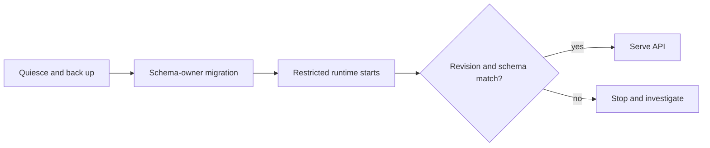
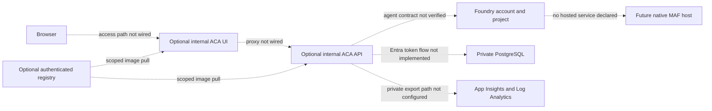
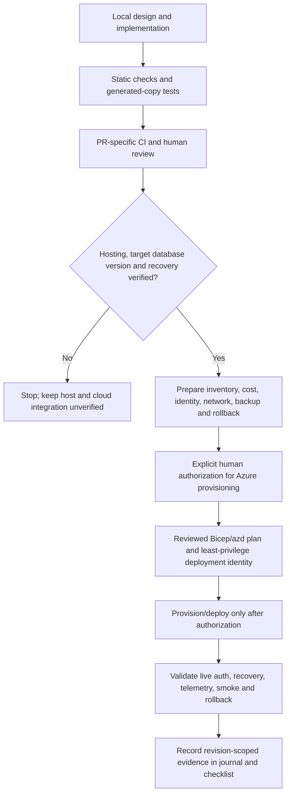

# Deployment and validation flow

## Status boundary

**Implemented:** local development, Docker Compose, source tests, generated
project tests, staged Bicep/azd definitions and credential-free static checks.
The latest verified integrated snapshot is PR #17 head
`fcd8f6f4f5cf48d537b9183aefa35b6b079feb76`, based on
`1e99e038dc31c0ae25e5ea7712030d204ee35bc0`; all six jobs passed in
[run 44957081895](https://github.com/ppenumatsa1/agent-blueprints/actions/runs/44957081895).
Merge ref `3c9c5842fc29b34e70b7c33b7be8beb215a9735c` had exact base/head
parents and a tree identical to the head. Any later tree or base change also
requires revalidation. These checks are not readiness or deployment evidence.

**Planned and unverified:** azd provisioning/deployment, Foundry-hosted MAF,
managed identity binding, Azure resource validation, cloud telemetry ingestion,
an ACA workflow alternative, and live sign-in. Explicit Azure trace and
metric exporter configuration is implemented but not cloud-verified. This
document does not authorize a cloud deployment command. Track infrastructure
wiring [#18](https://github.com/ppenumatsa1/agent-blueprints/issues/18),
managed database operations [#24](https://github.com/ppenumatsa1/agent-blueprints/issues/24),
and deployment [#28](https://github.com/ppenumatsa1/agent-blueprints/issues/28).
Cross-platform debugging [#23](https://github.com/ppenumatsa1/agent-blueprints/issues/23),
live Entra/OBO and accessibility [#27](https://github.com/ppenumatsa1/agent-blueprints/issues/27),
and cloud telemetry [#26](https://github.com/ppenumatsa1/agent-blueprints/issues/26)
remain separate verification work.
Deployment's offline prerequisites are wired IaC, selected versions, reviewed
identity/network/secret configuration, static validation and separate human
authorization. An authorized live deployment is intended to produce evidence
for hosted/cloud issues; it need not wait for every live-verification issue to
be closed. No resource has been provisioned.
Read-only Azure subscription and resource-group listing returned HTTP 200;
no resources were changed. This does not verify write permission, private
service connectivity, application identity, or a deployment.

## Local development and Compose

1. Install Python 3.12, uv 0.9.26, Node 22, Docker with Compose, and an isolated
   PostgreSQL database for direct tests. Use authorized existing Entra
   registrations for interactive sign-in; registration and consent are not
   created by the project.
2. From `backend`, install the locked environment and run the targeted source
   suite:

   ```text
   uv sync --locked
   uv run --locked ruff check .
   uv run --locked ruff format --check .
   uv run --locked python -m unittest -v tests.test_core tests.test_security tests.test_evidence_runner tests.test_telemetry tests.test_migrations
   ```

3. From `frontend`, run `npm ci`, `npm test`, `npm run build`, and
   `npm run check-csp`.
4. From the project root, supply required environment variables, build the
   API, explicitly run the migration and synthetic preparation commands in
   [setup](../setup.md), then run `docker compose up --build --wait`.
   Only the UI binds to loopback. Review
   [setup](../setup.md) for secret handling and persistent-volume behavior.
5. Stop with `docker compose down`; volumes persist. Back up or delete data
   only under the operator's policy.



Compose uses one local database account for convenience, not as a production
least-privilege model. Production migration and runtime identities require
separate review; no live deployment or backup recovery is claimed.

### Compose configuration and startup

Compose requires `POSTGRES_PASSWORD`, `BLUEPRINT_APPLICATION`,
`ENTRA_TENANT_ID`, `ENTRA_API_CLIENT_ID`, `ENTRA_SPA_CLIENT_ID`, and
`ENTRA_API_APP_ID_URI`. Optional `BLUEPRINT_PORT` defaults to `8080`;
`NPM_REGISTRY` and `PYTHON_PACKAGE_INDEX` default to the public registries.
`OBO_ENABLED` defaults to `false`; enabling it also requires
`ENTRA_API_CLIENT_SECRET` and resource-qualified `OBO_ALLOWED_SCOPES`.
Never put credentials in the Vite `VITE_*` build arguments; they are public
browser configuration. Full purpose and sensitivity descriptions are in
[setup](../setup.md).

`compose.yaml` starts PostgreSQL 17 and waits for its readiness probe before
starting the API. A schema owner runs the explicit Alembic upgrade separately;
API startup validates the expected revision without DDL, initializes the
selected application factory, then attempts recovery of recoverable cases
before its health check succeeds. The web container waits for API health and
is the only published service; its port is bound to `127.0.0.1`. Named volumes
retain PostgreSQL data and local file checkpoints across `docker compose down`.

```mermaid
sequenceDiagram
    participant Operator
    participant Compose
    participant DB as PostgreSQL 17
    participant API as FastAPI + local MAF
    participant Web as React web container
    Operator->>Compose: up --build --wait with required environment
    Compose->>DB: Start; wait for pg_isready
    Compose->>API: Start with DB URL and private checkpoint volume
    Operator->>DB: Apply explicit schema-owner migration
    API->>DB: Validate expected migration revision; no DDL
    API->>API: Build application components
    API->>DB: Enumerate recoverable cases
    API->>API: Reconcile local checkpoints under case lock
    Compose->>Web: Build with public Vite Entra settings
    Compose->>Web: Start after API /healthz succeeds
    Operator->>Web: Browse on loopback HTTP
```

The migration path rejects unknown or drifted baselines; guarded legacy
adoption requires exact manifest verification and no later-revision-owned
tables. Fresh databases run the baseline revision normally. Local recovery is
single-host and uses the persistent file-checkpoint volume. Do not copy this
topology to a hosted runtime:
Foundry-managed checkpoint recovery, caller binding, and lost-response
handling remain unresolved; see [#19](https://github.com/ppenumatsa1/agent-blueprints/issues/19),
[#20](https://github.com/ppenumatsa1/agent-blueprints/issues/20), and
[#22](https://github.com/ppenumatsa1/agent-blueprints/issues/22). Hosted
recovery is explicitly deferred to scoped follow-up, not waived.

## Staged Foundry-first infrastructure

The following is a static target, not a deployed data path:



The optional model, project-wide API agent-consumer grant, registry and
Container Apps default off. Foundry public access and monitoring public
ingestion/query are disabled, but this increment does not provide their private
endpoints or verify any runtime connection. PostgreSQL uses a delegated subnet,
private DNS and Entra-only authentication; the existing API does not acquire a
database token. The staged server selects PostgreSQL 16, whereas local Compose
uses 17. Twelve focused tests on a separate migration revision passed against
local PostgreSQL 16.15; migration compatibility with the Azure target remains
unverified. PR #16's merge commit
`d1251352835c2d02e91690104b4dcabf465f5f05` passed all five jobs in
[run 44947337144](https://github.com/ppenumatsa1/agent-blueprints/actions/runs/44947337144),
with generated instantiation/link validation and 47 root tests plus one
expected skip. Those results are PR #16-specific, not the combined PR #17
revision. Container
Apps platform auth is a separately applied resource; application-level
authentication and record authorization remain mandatory even if it fails.
The optional registry is publicly network-reachable but disallows anonymous
and admin access. The eventual agent-scoped caller binding and inherited role
assignments still need review; no endpoint caller exclusivity is established.
ACA internal ingress is environment-scoped, so the UI is not directly
reachable by a browser elsewhere on the VNet. See the
[infrastructure guide](../../infra/README.md) for all limitations.

## CI and independent generation

The source `.github/workflows/ci.yml` runs `contracts`, `maf-infrastructure`,
PostgreSQL-backed `maf-core`, `maf-frontend` tests/build/CSP, `maf-compose`
HTTP/permission checks, and `maf-independent`. The independent job generates
outside the checkout, checks its own imports and build contexts, runs generated
infrastructure/backend/frontend/verification tests, validates synthetic
evidence disclosures, and builds the generated Compose stack. Its verifier
step propagates failures through `tee` and rejects skipped or expected-failure
results; `tests/test_ci_workflow.py` exercises these paths against the actual
workflow step. CI does not provision Azure or prove live Entra/Foundry
behavior.

From either the source blueprint or generated project root, with Python 3.12
and Bicep 0.49.2 or newer installed:

```text
python infra/validate.py
python -m unittest discover -s infra/tests -v
```

These compile and lint local modules, check synthetic parameter examples and
local azd paths, and inspect compiled security properties. They cannot validate
arbitrary future parameters or live Azure behavior. See
[infrastructure preparation](../../infra/README.md).

The staged server selects PostgreSQL 16 while Compose uses 17. A separate
migration revision passed 12 tests on local PostgreSQL 16.15, including
fresh, upgrade and drift cases; its initial auxiliary locale probe failed and
was corrected. Bicep compilation and local tests do not verify Azure
compatibility. Resolve the [version gap](../../infra/README.md#open-postgresql-version-gap)
and repeat migration tests on the exact integrated revision and selected
target before deployment; no automatic downgrade or cross-major data
compatibility is assumed. Track managed PostgreSQL migration, restore and
least-privilege operations in
[#24](https://github.com/ppenumatsa1/agent-blueprints/issues/24).

Before PR approval:

1. Generate a fresh project outside the repository and verify all documentation,
   contract bytes, and imports are independent.
2. Run focused regression, security, durability, and independent checks
   affected by the change. For contract changes, run
   `python -m unittest discover -s tests -v` with the source repository's
   root `requirements-dev.txt` installed in an isolated environment.
3. Confirm all required GitHub Actions checks belong to the exact PR head
   revision. A prior commit's green run is not evidence for a new revision.
4. Review the diff for compatibility shims, duplicate implementations,
   unused dependencies, stale paths, secrets, and unverified claims.

## Future Azure delivery gates



The checked-in modules and `azure.yaml` are staged definitions, not a supported
deployment path. Foundry and monitoring lack private endpoints; PostgreSQL
Entra token authentication and the API/UI/host bindings are not implemented.
Review scoped identity and network access, image provenance, cost and teardown
ownership, and live behavior before requesting authorization. Foundry's
host-managed checkpoint strategy and an ACA-compatible strategy are distinct;
neither may silently fall back to local file checkpoints. A public endpoint
must remain authenticated and authorized.

See [deployment design](../deployment.md) for the current prototype boundary
and [journal](issues-changes-fixes.md) for evidence and outstanding work.
