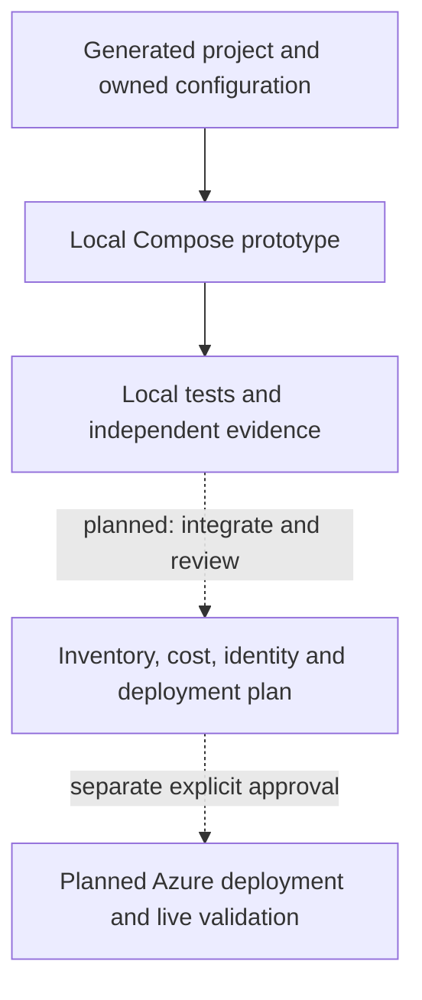

# Deployment flow

Only the local Compose path is supplied today. The dotted path is a proposal,
not a working deployment pipeline. Before cloud deployment, verify framework
and hosting compatibility, checkpoint ownership, recovery, authorization,
secrets, network posture, database access, observability and resource
permissions; record failures and unverified outcomes. Foundry-first hosting,
IaC and Azure Monitor are planned and unverified. No resource creation is
authorized by this design.

See [deployment design](../deployment.md) and [setup](../setup.md).
