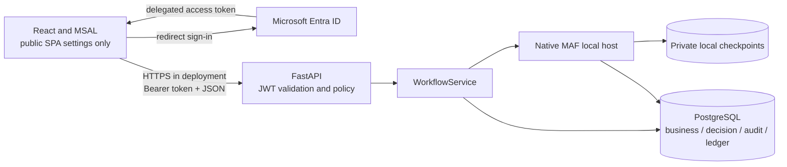
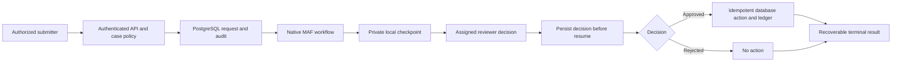

# Product requirements: MAF workflow blueprint

## Problem and objective

Application teams need a reusable, framework-native starting point for a
workflow that pauses for a durable human decision and resumes without
duplicating an authorized database action. They also need to generate and own
a separate project rather than depend on this repository at runtime.

The objective is a locally runnable React/MSAL, FastAPI, Microsoft Agent
Framework (MAF), PostgreSQL, and Docker Compose blueprint. It demonstrates
separation of workflow checkpoints from business state, server-side
authentication and authorization, idempotent application-owned effects, and
independent project generation. The included action and acceptance scenario
are synthetic fixtures, not a business application.

## Delivery status and boundary

The checked-in product is the **local** blueprint: one FastAPI process owns
the API, workflow service, local MAF host, and PostgreSQL adapter; React is
served by the Compose web container. `WORKFLOW_HOST=local` is the only
accepted host mode. Local `FileCheckpointStorage` is private and
single-host; PostgreSQL separately stores business, decision, audit, and
action-ledger records.

Foundry-hosted execution, host-managed checkpoints, hosted identity binding,
lost-response reconciliation, cloud telemetry, ACA hosting, Bicep, and azd
deployment are **planned or blocked**, not alternate configured runtime
modes. The example's database schema is initialized by `PostgresStore` at
startup; versioned migrations and production schema administration are not
implemented. No Azure resource or permanent repository creation is authorized
by this PRD.

## Users and needs

| User | Need |
| --- | --- |
| Blueprint adopter | Generate a self-contained project, configure an application factory, and understand the local boundaries. |
| Request owner | Submit a request and inspect only records authorized to them. |
| Assigned reviewer | Review and approve or reject a pending request under server-enforced policy. |
| Operator | Start the local stack, diagnose failures without exposing tokens or payloads, and protect persistent volumes. |
| Maintainer | Tie requirements to source, regression evidence, generated-copy checks, and revision-specific CI. |

## User and system contract

The browser uses MSAL to acquire a delegated access token for one of three
API scopes: `workflow.read`, `workflow.write`, or `workflow.approve`. FastAPI
validates the Entra v2 token signature, issuer, audience, tenant, time claims,
and delegated scopes. The default policy permits a submitter to read their
own case and an assigned reviewer to read it; a decision additionally
requires the `Workflow.Approver` role and a different reviewer identity.
Client-side visibility is not an authorization control.

The API boundary is intentionally small:

| Operation | Contract | Required authority |
| --- | --- | --- |
| `GET /healthz` | Liveness response, no business record | None |
| `POST /api/cases` | `{ reviewer_id, payload }` plus `Idempotency-Key` | `workflow.write`; reviewer differs from submitter |
| `GET /api/cases/{case_id}` | Case status and payload | `workflow.read`; owner or assigned reviewer in same tenant |
| `POST /api/cases/{case_id}/decision` | `{ decision: approved \| rejected }` | `workflow.approve`, `Workflow.Approver`, assigned reviewer |

Submission validation rejects extra fields and non-object payloads; the
domain-neutral payload ceiling is 16 KiB. Reusing an idempotency key with a
different canonical request conflicts. Decision rows are immutable: a
different decision or actor conflicts rather than replacing the stored
decision.

## Runtime and trust boundaries

In the checked-in Compose prototype the UI is bound to loopback HTTP; this is
not a production TLS topology. The API and database have no published host
ports. `ENTRA_API_CLIENT_SECRET` is server-only and optional OBO is off by
default; the synthetic application makes no downstream OBO call. An
`X-Correlation-ID` is generated per API request; a case ID is the case
correlation identifier. Neither is authorization.

## Functional requirements

| ID | Requirement |
| --- | --- |
| FR-01 | Generate a new project outside the repository with its own backend, frontend, Docker contexts, documentation, and independent verification assets. |
| FR-02 | Authenticate API calls with validated Entra bearer tokens; authorize submission, record reads, and decisions on the server. |
| FR-03 | Persist requests, decisions, audit events, and database-action ledger entries in PostgreSQL. |
| FR-04 | Run a native MAF workflow that issues one case-bound approval request and emits one matching outcome. |
| FR-05 | Require a different, assigned reviewer and persist their decision before resuming the workflow. |
| FR-06 | Use an idempotency key and transactional database ledger for same-transaction effects; surface failures rather than fabricating a result. |
| FR-07 | Recover local work across the tested decision-persistence and action-commit crash windows using private local checkpoints and database reconciliation. |
| FR-08 | Provide a React/MSAL UI for sign-in, request submission, record reads, decisions, and visible failure states. |
| FR-09 | Include independently generated documentation, tests, exact contract bytes, and readiness verification without repository imports or bind mounts. |

## Non-functional requirements

- **Security:** Protected endpoints require authentication and authorization.
  Treat request/model/tool inputs as untrusted. Do not place secrets in browser
  configuration, source, images, logs, or generated examples.
- **Durability:** Keep MAF checkpoint state distinct from PostgreSQL business,
  decision, audit, and action-ledger state. Local file checkpoints are
  single-host and are not a hosted recovery mechanism.
- **Privacy:** Do not log access tokens, authorization codes, secrets, or
  business payloads. Keep API failures safe and actionable.
- **Independence:** Generated output owns its runtime and verification files;
  it does not import or mount this source repository.
- **Evidence:** Keep failed and unverified outcomes distinct from passing
  checks. Schema validity or a synthetic approval is not release authorization.
- **Maintainability:** Maintain one canonical implementation, direct imports,
  and design documents copied with the blueprint. Remove legacy forwarding
  modules and obsolete files before PR approval.

## Scope and exclusions

**Current scope:** local single-host prototype, selected application factory,
Entra integration points, PostgreSQL records and action ledger, MAF native
workflow with `FileCheckpointStorage`, React/MSAL client, Compose packaging,
generated project, and local/hosted regression tests.

**Not implemented or verified:** live Entra sign-in and OBO, production
secrets management, external side-effect exactly-once behavior, versioned
database migrations, cloud telemetry export, Foundry-hosted execution and
managed checkpoint recovery, ACA recovery, Bicep/azd provisioning, and a
production deployment. Azure resource creation and permanent repository
creation require separate approval.

## Acceptance criteria

1. A generated copy contains the blueprint guides and all eight `docs/design`
   documents byte-for-byte; local Markdown links resolve in that copy.
2. Tests cover authorization boundaries, idempotent decisions/actions, and
   both documented worker-crash windows.
3. Independent generated verification exercises the actual test adapter and
   reports synthetic approval/recovery observations separately from unverified
   explanation/hint and trust claims.
4. `GET /healthz` is an unauthenticated liveness check; all `/api/` routes
   require a validated bearer token, and each record operation enforces
   tenant, owner/reviewer, scope, and role policy.
5. Compose runs the UI on loopback, keeps API/database ports unpublished, and
   requires explicit origins if CORS is enabled; this does not prove live
   Entra use or a production network boundary.
6. CI results are checked on the actual PR head revision. No PR is finalized
   with compatibility shims, forwarding modules, unused dependencies, or
   obsolete configuration still present.

The source implementation and validation locations are mapped in
[specifications](specs.md). The reference project's documentation structure
informs the viewpoints and traceability here; its order-resolution behavior,
deployment configuration, and domain examples are not part of this blueprint.

## Workflow at a glance

See [specifications](specs.md) for implementation and verification mapping,
and [user flow](userflow.md) for the detailed authorization and failure paths.
