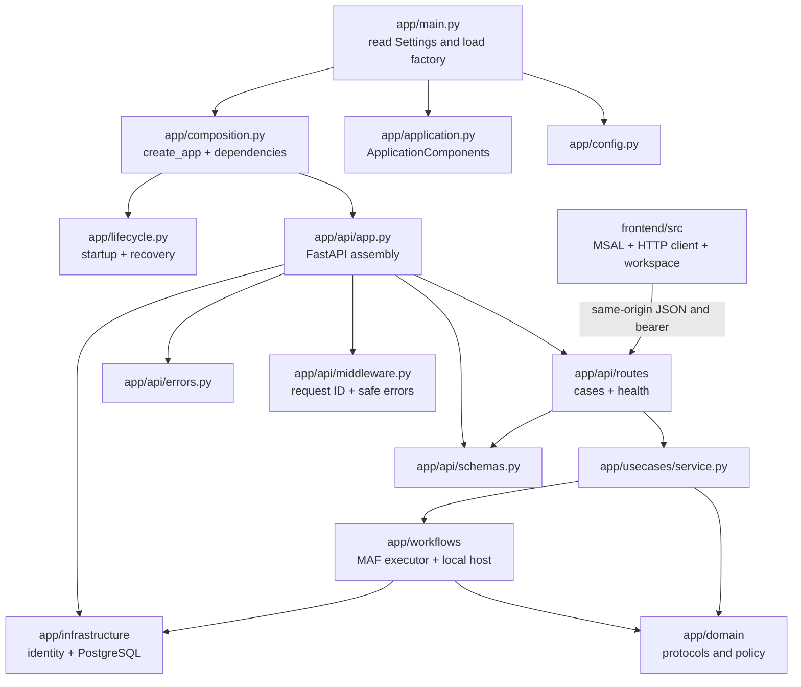

# Project structure

## Canonical blueprint tree

The tree below describes the intended single-source layout. The generator
copies the complete blueprint directory into a new project, then adds a
separate `verification/` tree. It is not a shared runtime dependency.

```text
maf-workflow/
├── README.md
├── compose.yaml
├── azure.yaml                  # staged API/UI descriptors, no hosted agent
├── .dockerignore
├── .vscode/
│   ├── launch.json
│   └── tasks.json
├── infra/
│   ├── main.bicep
│   ├── main.parameters.json
│   ├── bicepconfig.json
│   ├── validate.py
│   ├── environments/           # synthetic non-secret examples
│   ├── modules/                # local Foundry, network, DB, monitoring, identities, registry, apps
│   └── tests/
├── backend/
│   ├── Dockerfile
│   ├── .python-version
│   ├── agent-framework-core.sha256
│   ├── pyproject.toml
│   ├── uv.lock
│   ├── scripts/
│   │   └── verify_framework_supply_chain.py
│   ├── examples/
│   │   └── synthetic_application.py
│   ├── app/
│   │   ├── main.py
│   │   ├── composition.py         # create_app and dependency wiring
│   │   ├── application.py         # module:function application factory
│   │   ├── config.py              # environment validation
│   │   ├── lifecycle.py           # startup initialization and recovery
│   │   ├── api/
│   │   │   ├── app.py             # FastAPI assembly, middleware and routers
│   │   │   ├── dependencies.py    # auth/service dependencies
│   │   │   ├── errors.py          # safe exception mapping
│   │   │   ├── middleware.py      # request IDs and safe-error boundary
│   │   │   ├── schemas.py         # request/response models
│   │   │   └── routes/
│   │   │       ├── cases.py       # submit/read/decision handlers
│   │   │       └── health.py      # liveness handler
│   │   ├── domain/                # errors, protocols, policy, case types
│   │   ├── usecases/service.py    # submit, read, decide coordination
│   │   ├── workflows/             # native executor and local host
│   │   └── infrastructure/        # Entra/OBO, PostgreSQL, telemetry
│   ├── migrations/
│   │   ├── baseline.sql
│   │   ├── manifests/
│   │   └── versions/
│   └── tests/                     # core, security, crash, evidence suites
├── frontend/
│   ├── Dockerfile
│   ├── package.json
│   ├── package-lock.json
│   └── src/
│       ├── main.tsx               # MSAL bootstrap and config failure UI
│       ├── config.ts              # VITE_* public settings and scopes
│       ├── authenticated-app.tsx  # account selection/token acquisition
│       ├── api.ts                 # typed HTTP client and response guards
│       ├── workspace.tsx          # submit/read/decision UI
│       └── test/                  # client, auth, workspace tests
└── docs/
    ├── architecture.md
    ├── setup.md
    ├── development.md
    ├── testing.md
    ├── deployment.md
    ├── operations.md
    └── design/
        ├── prd.md
        ├── techstack.md
        ├── specs.md
        ├── architecture.md
        ├── projectstructure.md
        ├── userflow.md
        ├── deployment-flow.md
        └── issues-changes-fixes.md
```

Generated-only verification assets are produced by the source repository's
`scripts/instantiate_maf.py` and include
`verification/readiness`, `verification/contracts`,
`verification/scenarios`, `verification/tests`, and `verification/docs`.
Their tests and contract bytes are copied from source but their execution
occurs in the generated directory.

The checked-in blueprint tree above is distinct from the **source repository**
tree. The generator script, root `.github/workflows/ci.yml`, `tests/test_*`,
and readiness-validator source are not imported as a generated runtime.
Instead, `scripts/instantiate_maf.py` copies the blueprint and creates the
generated project's self-contained `verification/` directory. Generated docs
are copied byte-for-byte; links are checked relative to the copied tree by
`tests/test_instantiation.py`.

## Runtime composition and dependency direction



The API boundaries are now split into canonical modules: `composition.py`
constructs the application components and delegates HTTP assembly to
`api/app.py`; route handlers and schemas live under `api/`, while
`lifecycle.py` owns startup initialization and recovery. No `app.api`
forwarding shim is retained. The architecture table below records these
responsibilities and their direct imports.

## Component responsibilities

| Path | Responsibility | Extension rule |
| --- | --- | --- |
| `backend/app/main.py` | Read environment settings and load the selected application factory before serving. | Keep module import failures and invalid configuration explicit. |
| `backend/app/composition.py` | `create_app()` wires repository, identity provider, local workflow host, service, and lifespan, then creates the API app. | Keep composition explicit; accept narrow repository/identity ports for tests. |
| `backend/app/api/app.py` | `create_api_app()` constructs FastAPI state, registers CORS, request/error middleware, exception handlers, and health/case routers. | Assemble transport concerns only; keep route business transitions in the use case. |
| `backend/app/api/routes/` | `cases.py` implements submit/read/decision handlers; `health.py` exposes liveness. | Require identity and service dependencies on protected handlers; keep liveness free of business state. |
| `backend/app/api/schemas.py` | Strict request/response models and domain-case to API-output mapping. | Reject extra fields and keep transport types out of domain policy. |
| `backend/app/api/dependencies.py` | Resolve authenticated request identity and `WorkflowService` from app state. | Require bearer authentication for case routes; test through injected identity providers. |
| `backend/app/api/errors.py` | Map domain and validation failures to safe HTTP responses. | Preserve status semantics without exposing exception details. |
| `backend/app/api/middleware.py` | Add request correlation ID and generic safe-error handling. | Keep logs free of credentials and payloads. |
| `backend/app/lifecycle.py` | Creates the FastAPI lifespan for schema-revision validation, app initialization, and recovery of incomplete cases. | Keep startup ordering and per-case recovery failures observable; runtime performs no schema DDL. |
| `backend/app/application.py` | Load `module:function`, validate `ApplicationComponents`, and provide its workflow factory default. | Supply app-owned rules, policy, action, setup and optional native workflow factory. |
| `backend/app/extensions/` | Typed MAF model selection, prompt asset, agent construction and tool registration boundaries. | Provider factories, prompts, tools and authorization stay app-owned; no live provider call or authorization proof is implied. See [architecture](../architecture.md#typed-maf-extension-patterns) and [#35](https://github.com/ppenumatsa1/agent-blueprints/issues/35). |
| `backend/app/config.py` | Parse required tenant/API UUIDs, PostgreSQL URL, local checkpoint directory, explicit CORS origins, local-only host mode, and optional OBO scopes. | Reject invalid values; secrets are hidden from dataclass representation and must remain server-only. |
| `backend/app/domain/` | Generic principals, cases, errors, state/action/workflow protocols and policy. | Keep domain-agnostic; do not move scenario business rules into the generic layer. |
| `backend/app/usecases/` | Coordinate authorization-approved request, decision, and workflow operations. | Preserve decision-before-resume and idempotent semantics. |
| `backend/app/workflows/` | Native MAF executor/workflow and local host/checkpoint recovery. | Preserve pending request identity and matching terminal outcome; host adapters own their provider. Compose app-owned executors with MAF `WorkflowBuilder` through the typed `WorkflowFactory`; hosted execution remains separate under [#19](https://github.com/ppenumatsa1/agent-blueprints/issues/19). |
| `backend/app/infrastructure/` | PostgreSQL schema/store, Entra identity, and optional OBO adapter. | Keep credentials private; schema and checkpoint stores remain distinct. |
| `backend/app/infrastructure/telemetry.py` | Manual privacy-safe traces, metrics, and structured operational logs. | Keep signal fields allowlisted; do not capture payloads, identities, or secrets. |
| `backend/scripts/verify_framework_supply_chain.py` | Rejects the compromised MAF umbrella distribution and verifies the approved core wheel against the canonical lock and SHA-256 approval. | Keep `uv.lock` as the sole dependency graph; installation remains locked and hash-verified through uv. |
| `backend/agent-framework-core.sha256` | Approved `agent-framework-core==1.26.0` wheel digest. | Update only with reviewed package approval and a matching locked wheel hash. |
| `backend/migrations/` | Reviewed Alembic revisions and version-specific schema manifests. | Run explicit owner upgrades; runtime validates without DDL. |
| `backend/examples/` | Explicitly selected synthetic application. | Never treat as a production fallback or customer example. |
| `backend/tests/` | PostgreSQL integration, security, crash recovery, and synthetic evidence tests. | Use isolated test DB and test-only identity providers. |
| `frontend/src/` | MSAL app, typed API client, reusable workspace and UI tests. | Keep access tokens transient and do not embed service secrets. |
| `azure.yaml`, `infra/` | Staged Foundry-first resource graph, service paths and credential-free checks. | Keep each generated project self-contained; do not add a hosted service until its real interface is verified. |
| `docs/` | Maintainer, adopter, operator, design, and journal documentation. | Update affected docs with each meaningful implementation change. |
| Generated `verification/` | Independent readiness contracts, verifier, tests, and fixture evidence. | Never import the source checkout or claim unsigned fixtures authorize release. |

## Composition and startup ownership

`app.main` evaluates `Settings.from_environment()` and
`load_application(BLUEPRINT_APPLICATION)`, then calls `create_app()` from
`composition.py`. That composition wires `PostgresStore`, `EntraIdentity`,
`LocalWorkflowHost`, `WorkflowService`, and `create_lifespan()` before
delegating HTTP setup to `create_api_app()` in `api/app.py`. A schema owner
applies the explicit migration before startup; the lifespan validates the
expected revision without DDL, invokes the application initializer, then
starts or resumes incomplete cases before yielding to request handling.
PostgreSQL owns case/business decision/audit and action-ledger records; MAF
`FileCheckpointStorage` owns local continuation state. The checkpoint root is
private and case-scoped. Guarded legacy adoption and fresh-database migration
behavior are covered by `backend/tests/test_migrations.py`; this is not live
backup/restore evidence.

The browser reads `VITE_ENTRA_TENANT_ID`, `VITE_ENTRA_SPA_CLIENT_ID`, and
`VITE_ENTRA_API_APP_ID_URI` at build time. It requests one scope per operation
and sends only a bearer token and JSON to same-origin `/api/` routes. No API or
database port is published by Compose; Vite values are public and cannot
contain client secrets.

## Canonical source and cleanup

The directory tree is the canonical target; compatibility forwarding modules,
legacy import aliases, duplicate code, obsolete directories, unused
dependencies, and stale configuration are not extension points. Before PR
approval, use direct imports and update tests, Dockerfiles, CI, docs, and
instantiation scripts together when removing an old path. Backward
compatibility with previous internal layouts is unnecessary for this
greenfield blueprint.

See [architecture](architecture.md) for dependency directions and
[specifications](specs.md) for implementation-to-test mapping.
