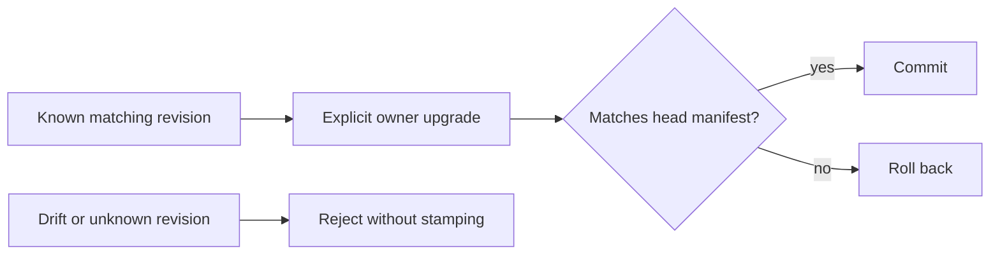

# Technical specifications

These specifications define the current local blueprint's observable
contracts. Each row points to source and a verification boundary; a green
test is evidence only for the behavior it exercises.

| ID | Requirement | Implementation | Verification and limit |
| --- | --- | --- | --- |
| SPEC-01 | Generated project is independent and refuses unsafe destinations. | The source repository's `scripts/instantiate_maf.py` copies the blueprint, license, contracts, verifier, and synthetic fixture. | The source repository's `tests/test_instantiation.py` verifies outside-repository generation, import isolation, byte-identical contracts/docs, and refusal of existing/repository destinations. |
| SPEC-02 | Protected API calls authenticate an Entra v2 bearer token and authorize each operation. | [`backend/app/infrastructure/identity.py`](../../backend/app/infrastructure/identity.py), [`backend/app/domain/policy.py`](../../backend/app/domain/policy.py), [`backend/app/api/dependencies.py`](../../backend/app/api/dependencies.py), [`backend/app/api/routes/cases.py`](../../backend/app/api/routes/cases.py), and [`backend/app/composition.py`](../../backend/app/composition.py). | `backend/tests/test_security.py`; synthetic identities do not prove live Entra sign-in, role assignment, or OBO. |
| SPEC-03 | Requests and reviewer decisions are persisted before workflow continuation. | [`backend/app/usecases/service.py`](../../backend/app/usecases/service.py), [`backend/app/infrastructure/store.py`](../../backend/app/infrastructure/store.py), [`backend/migrations/baseline.sql`](../../backend/migrations/baseline.sql). | `backend/tests/test_core.py`; tests use isolated PostgreSQL, not a production database. |
| SPEC-04 | Workflow uses MAF-native request/response and host-owned local checkpoint provider; select run-scoped persisted checkpoints rather than timestamp order and reject incomplete terminal checkpoints on completion or replay. | [`backend/app/workflows/workflow.py`](../../backend/app/workflows/workflow.py), [`backend/app/workflows/host.py`](../../backend/app/workflows/host.py). | `backend/tests/test_core.py` checks request restoration, equal timestamps, terminal write failure, nonterminal replay and outcomes. Foundry-managed checkpoint behavior is unverified. |
| SPEC-05 | Database effects and action ledger commit together; repeated application is safe for the same database transaction. | [`backend/app/infrastructure/store.py`](../../backend/app/infrastructure/store.py), `wf_action_ledger` in `baseline.sql`. | Crash-after-action-commit test in `backend/tests/test_core.py`. Consequential external effects require service-specific authorization, verified downstream idempotency and authoritative reconciliation; otherwise fail closed and use manual resolution, not an ambiguous retry. An outbox only persists intent and cannot deduplicate an external effect after a lost acknowledgment; no universal exactly-once promise. |
| SPEC-06 | Recovery reconciles separate file checkpoints and SQL records across tested crash windows. | `LocalWorkflowHost`, `PostgresStore.recoverable`, `resume`, and `finish`. | Worker-termination tests in `backend/tests/test_core.py`; these do not test multi-host failover or hosted recovery. |
| SPEC-07 | Browser uses MSAL scopes and does not receive service credentials. | [`frontend/src/authenticated-app.tsx`](../../frontend/src/authenticated-app.tsx), [`frontend/src/api.ts`](../../frontend/src/api.ts), [`frontend/src/config.ts`](../../frontend/src/config.ts). | `frontend/src/test/`; Compose CI checks public SPA configuration, health status, protected API 401, and container permissions. Interactive sign-in remains unverified. |
| SPEC-08 | Local Compose exposure is restricted to loopback UI; API/database are internal services. | [`compose.yaml`](../../compose.yaml), frontend `nginx.conf`, backend Dockerfile. | `maf-compose` CI smoke. It is not a production security or Azure deployment assessment. |
| SPEC-09 | Synthetic verification distinguishes passing observations from unverified evidence. | Generated `verification/`, `backend/tests/evidence_runner.py`, and `readiness/`. | `maf-independent` CI job checks expected approval/recovery observations and unverified explanation/hint outcomes. Its empty trust store cannot authorize release. |
| SPEC-10 | The eight design documents and local guides are copied into every generated project and remain navigable. | This `docs/` tree is copied by the source repository's `scripts/instantiate_maf.py`. | The source repository's `tests/test_instantiation.py` compares source and generated Markdown bytes and validates local links. |
| SPEC-11 | No PR is finalized with shims, obsolete paths, unused dependencies, or stale configuration. | The source repository's cross-cutting acceptance gate is in `docs/implementation-plan.md`. | Review source, tests, Dockerfiles, CI, docs, and generator together; add regression tests for changed behavior and inspect CI on the exact PR head. |
| SPEC-12 | Explicit migration upgrades only known matching revisions; runtime checks head without DDL. | [`backend/app/infrastructure/migrations.py`](../../backend/app/infrastructure/migrations.py), [`backend/migrations/baseline.sql`](../../backend/migrations/baseline.sql), and revision manifests. | `backend/tests/test_migrations.py`: fresh, prior revision, data preservation, drift, rollback, concurrency, and restricted-role startup. Live backup/restore remains unverified. |
| SPEC-13 | Provide privacy-safe correlation, traces and allowlisted metrics; explicitly configure Azure export and isolate runtime instrumentation failures without retries or exception masking. Do not enable native global auto-instrumentation until privacy is verified. | [`backend/app/infrastructure/telemetry.py`](../../backend/app/infrastructure/telemetry.py), [`backend/app/api/middleware.py`](../../backend/app/api/middleware.py), and [`frontend/src/api.ts`](../../frontend/src/api.ts). | The integrated `3aa389f` fix disables unsafe auto-instrumentation and replaces private metric SDK access; 23 focused regressions passed. Historical combined source/generated suites passed 72 tests each at `98091a3` on base `8144918`. Exact #17 head `8b3c357` passed `maf-core` and `maf-independent` in run 44960731511; this does not establish cloud ingestion. The prior native opt-in probe emitted duplicate FastAPI spans and leaked a synthetic query canary. Hosted ingestion remains unverified; track [#26](https://github.com/ppenumatsa1/agent-blueprints/issues/26). |
| SPEC-14 | Backend and generated projects use a portable locked dependency graph and consistent lint checks. | [`backend/pyproject.toml`](../../backend/pyproject.toml), [`backend/uv.lock`](../../backend/uv.lock), backend Dockerfile, and `.vscode/`. | Source and generated CI run locked installs, Ruff, backend tests and image builds; confirm the actual PR revision. macOS and interactive debugging remain unverified. |
| SPEC-15 | Source and independently generated IaC compile, lint, and validate their committed examples and local azd paths without Azure credentials. | [`infra/validate.py`](../../infra/validate.py), [`azure.yaml`](../../azure.yaml), the source repository's `maf-infrastructure` and `maf-independent` CI jobs. | `python infra/validate.py` and `python -m unittest discover -s infra/tests -v` check the local graph and examples, not arbitrary future inputs or Azure service availability. |
| SPEC-16 | Default infrastructure avoids public unauthenticated API exposure and limits identities, network paths and optional paid workloads. | [`infra/main.bicep`](../../infra/main.bicep) and its local modules, including [`container-apps.bicep`](../../infra/modules/container-apps.bicep). | The compiled-resource tests inspect internal ingress, Entra auth configuration, disabled Foundry public data-plane access, private PostgreSQL, monitoring settings, role scopes and disabled options. Actual access, role propagation, platform auth, private connectivity and application authorization remain unverified. |
| SPEC-17 | Hosted workflow integration remains separate from UI/API infrastructure until caller-to-session authorization, its contract, and recovery are proven. | [`infra/README.md`](../../infra/README.md) records output candidates and missing prerequisites; no hosted-agent service is declared. | No deployed agent, verified mapping from application principal to hosted identity/session, managed checkpoints or ambiguous-response recovery has been validated. AgentServer one-shot task IDs are only a candidate inner operation key, not completed-result deduplication or Responses-create idempotency. |
| SPEC-18 | Database-version differences are disclosed and migration compatibility is verified against the chosen target before deployment. | [`compose.yaml`](../../compose.yaml), [`postgres.bicep`](../../infra/modules/postgres.bicep), and the [version-gap disclosure](../../infra/README.md#open-postgresql-version-gap). | `infra/tests/test_validation.py` checks the disclosed majors. Compose uses 17; staged Azure selects 16. Local PostgreSQL 16.15 migration checks passed on a separate revision; Azure deployment remains unverified. |
| SPEC-19 | Local API authority comes from validated delegated identity and server policy, not caller-supplied IDs alone. A hosted bridge must verify an explicit mapping to the validated principal, map each authenticated caller to a distinct session, and reject unchecked client-supplied session IDs. Opaque `x-ms-user-identity` is not authorization and is not assumed to equal platform-generated `x-agent-user-id`. | [`backend/app/infrastructure/identity.py`](../../backend/app/infrastructure/identity.py), [`backend/app/domain/policy.py`](../../backend/app/domain/policy.py), [`backend/app/api/dependencies.py`](../../backend/app/api/dependencies.py), and [`backend/app/api/routes/cases.py`](../../backend/app/api/routes/cases.py). Hosted constraint: [Microsoft per-user isolation guidance](https://learn.microsoft.com/azure/foundry/agents/how-to/isolate-sessions-per-user). | `backend/tests/test_security.py` exercises local token rejection, scope/role checks, tenant and record ownership, and unauthorized decisions. It does not test hosted principal/header/session mapping. Live Entra sign-in/OBO and hosted per-user isolation remain unverified. |
| SPEC-20 | Startup validates the expected schema revision, initializes application components, and recovers only incomplete cases before requests are served. | [`backend/app/lifecycle.py`](../../backend/app/lifecycle.py) creates the FastAPI lifespan; [`backend/app/composition.py`](../../backend/app/composition.py) wires it into [`backend/app/api/app.py`](../../backend/app/api/app.py); recovery uses `backend/app/infrastructure/store.py::recoverable` and `backend/app/workflows/host.py`. | `backend/tests/test_security.py` startup-recovery cases, `backend/tests/test_core.py` crash/restart cases, and `backend/tests/test_migrations.py` revision validation. Runtime startup performs no DDL. |
| SPEC-21 | Generated-verifier failure, skipped tests, or expected failures cannot be hidden by output capture. | Source `.github/workflows/ci.yml`, `tests/test_ci_workflow.py`; generated acceptance command in the independent job. | The workflow regression test executes the actual shell step with four output/status combinations. Hosted job status must still be tied to the exact commit and actual verifier logs. |
| SPEC-22 | Runtime and public frontend settings are explicit; secrets remain server-side. | [`backend/app/config.py`](../../backend/app/config.py), [`frontend/src/config.ts`](../../frontend/src/config.ts), and [`compose.yaml`](../../compose.yaml). | `backend/tests/test_security.py` validates configuration origins and OBO settings; `frontend/src/test/authentication.test.tsx` verifies client auth states. No live registration, secret manager, or production origin is configured here. |

### Issue-linked implementation and verification gaps

| Specification | Follow-up |
| --- | --- |
| SPEC-01, SPEC-10: independent generated project and fixture documentation | `maf-independent` passed on exact #17 head `8b3c357` in run 44960731511, confirming generation, documentation copy and links on that tree. A permanent standalone reference application is P1 and requires separate authorization [#30](https://github.com/ppenumatsa1/agent-blueprints/issues/30). |
| SPEC-02, SPEC-07, SPEC-22: live identity, OBO and interactive browser/accessibility verification | [#27](https://github.com/ppenumatsa1/agent-blueprints/issues/27). |
| SPEC-05: remote side effects beyond the same-PostgreSQL transaction | [#32](https://github.com/ppenumatsa1/agent-blueprints/issues/32). |
| SPEC-09: independent trust and real agent/browser-hint evidence | [#21](https://github.com/ppenumatsa1/agent-blueprints/issues/21), [#25](https://github.com/ppenumatsa1/agent-blueprints/issues/25). |
| SPEC-12, SPEC-18: managed PostgreSQL version, migration, backup/restore and operations | [#24](https://github.com/ppenumatsa1/agent-blueprints/issues/24). |
| SPEC-14: cross-platform locked tooling and interactive debugging | [#23](https://github.com/ppenumatsa1/agent-blueprints/issues/23). |
| SPEC-15, SPEC-16: staged infrastructure wiring and separately authorized deployment | [#18](https://github.com/ppenumatsa1/agent-blueprints/issues/18), [#28](https://github.com/ppenumatsa1/agent-blueprints/issues/28). |
| SPEC-17, SPEC-19: hosted workflow/checkpoints, lost-response recovery and caller/session binding | [#19](https://github.com/ppenumatsa1/agent-blueprints/issues/19), [#20](https://github.com/ppenumatsa1/agent-blueprints/issues/20), [#22](https://github.com/ppenumatsa1/agent-blueprints/issues/22). Hosted recovery is explicitly deferred, not waived. |
| Prototype demonstration and optional runtime alternatives | [#29](https://github.com/ppenumatsa1/agent-blueprints/issues/29), [#31](https://github.com/ppenumatsa1/agent-blueprints/issues/31). |
| Specification Studio producer handoff | [#33](https://github.com/ppenumatsa1/agent-blueprints/issues/33); no producer or adapter is authorized by this phase. |
| Later App/API blueprint roadmap | [#34](https://github.com/ppenumatsa1/agent-blueprints/issues/34); out of phase and requires separate authorization. The P1 permanent application is tracked separately in [#30](https://github.com/ppenumatsa1/agent-blueprints/issues/30). |
| Reusable model, agent, prompt, tool and executor extension contracts | Implemented as typed application-owned boundaries and a generated synthetic fixture with an application-owned native MAF workflow/executor. See [architecture](../architecture.md#typed-maf-extension-patterns), [#35](https://github.com/ppenumatsa1/agent-blueprints/issues/35), and draft [PR #37](https://github.com/ppenumatsa1/agent-blueprints/pull/37). The absolute non-bypass criterion remains unverified because arbitrary trusted callbacks are not sandboxed; model invocation, trusted provenance, hosted identity/recovery and external effects are not established by these tests. |
| Consequential external effects | P0 [#32](https://github.com/ppenumatsa1/agent-blueprints/issues/32); block remote actions pending service-specific authorization, verified downstream idempotency, authoritative reconciliation and fault-injection evidence; otherwise fail closed and use manual resolution. An outbox only persists intent, not downstream deduplication after a lost acknowledgment. |



## Change-control rules

1. Keep one canonical implementation and use direct imports. Remove forwarding
   modules, aliases, and obsolete directories; backward compatibility with
   prior internal paths is not a requirement for this greenfield blueprint.
2. When a source boundary changes, update dependent tests, Docker build
   contexts, CI, documentation, and instantiation behavior in the same
   coherent change.
3. Map each significant acceptance claim to its source and a focused
   verification. Mark unavailable evidence **unverified**; do not lower or
   relabel a failed or security-critical check.
4. Update the PRD/specifications/architecture/structure/flow/deployment docs
   affected by each meaningful implementation change and append its decision,
   issue, fix, evidence, and reusable lesson to the journal.
5. Verify the generated copy and run applicable regression, security,
   durability, and independent verification checks. Confirm hosted CI belongs
   to the exact proposed PR revision before requesting approval.

The policy is not proof that every current implementation item is complete.
See the [cumulative journal](issues-changes-fixes.md) for known open work and
the [deployment flow](deployment-flow.md) for unverified hosting boundaries.

## Observable request and recovery contract

```mermaid
sequenceDiagram
    actor Caller
    participant UI as React/MSAL
    participant API as FastAPI route
    participant Policy as Entra verifier + case policy
    participant Service as WorkflowService
    participant DB as PostgreSQL
    participant Host as Local MAF host
    participant CP as FileCheckpointStorage

    Caller->>UI: Sign in; choose request or decision
    UI->>API: Bearer token + scoped operation
    API->>Policy: Validate token and operation authority
    Policy-->>API: Principal or safe 401/403
    API->>Service: Submit / read / decide
    Service->>DB: Persist case, decision, audit, or ledger
    Service->>Host: Start or resume case
    Host->>CP: Save/restore native workflow checkpoint
    Host->>DB: Lock and reconcile checkpoint pointer/outcome
    API-->>UI: Case response or explicit 4xx/5xx
```

For `POST /api/cases`, a repeated `(tenant, owner, Idempotency-Key)` with an
identical canonical request returns the existing case; the same key with a
different request digest yields `409`. For decisions, only `approved` or
`rejected` are accepted; the server records the actor and refuses a different
decision/actor after the first decision. A decision is committed before the
host resumes MAF. The action and `wf_action_ledger` row share a PostgreSQL
transaction. This guarantee does not cover effects performed outside that
database transaction.

The API maps invalid authentication to `401`, policy denial to `403`, absent
records to `404`, state/idempotency conflicts to `409`, invalid JSON/contracts
to `422`, and unavailable checkpoint/action infrastructure to `503`. A
request-scoped `X-Correlation-ID` is returned; error bodies intentionally do
not expose exception details. Unknown exceptions are logged by type with the
correlation ID and return a generic `500`.

## Configuration and lifecycle contract

| Concern | Current value/source | Constraint |
| --- | --- | --- |
| Workflow host | `WORKFLOW_HOST=local` | `Settings` rejects any other value; no Foundry/ACA host adapter is present. |
| Application factory | `BLUEPRINT_APPLICATION=module:function` | Must return `ApplicationComponents`; app-specific logic remains outside generic workflow/domain code. |
| Identity | `ENTRA_TENANT_ID`, `ENTRA_API_CLIENT_ID`; browser uses `VITE_ENTRA_*` build args | API requires v2 RS256 token, configured issuer/audience/tenant, valid time claims, delegated scope; OBO is optional and disabled by default. |
| Persistence | PostgreSQL `DATABASE_URL`; local file `CHECKPOINT_ROOT` | A schema owner runs the explicit Alembic upgrade; runtime validates the expected revision without DDL. See SPEC-12 and the migration baseline. |
| CORS | Optional explicit `CORS_ORIGINS` | No wildcard; insecure HTTP only on loopback. Compose uses same-origin proxy and does not need broad CORS. |
| CI | Credential-free GitHub Actions | Verifies source, Compose, generated copy, and test contracts; it does not provision Azure. |

During FastAPI lifespan, `create_lifespan()` in `app/lifecycle.py` initializes
the store first, calls application initialization second, then starts or
resumes the records returned by `recoverable()` sequentially. A `Conflict`
means another worker already owns the case lock; action or blueprint recovery
errors are logged and the case is marked with a failure code. The top-level
`create_app()` in `app/composition.py` wires this lifecycle into
`create_api_app()` in `app/api/app.py`; it is covered by source security/core
suites, not a distributed failover contract.
