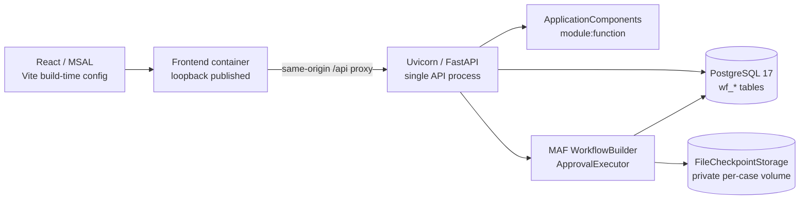

# Technology stack

This is the checked-in local-prototype baseline. Direct dependencies are
version-pinned in the manifests; that does not hash-lock the complete Python
dependency graph. Versions below are source configuration, not a claim about a
deployed environment.

## Runtime and dependencies

| Area | Current choice | Rationale and alternatives |
| --- | --- | --- |
| Python | Python 3.12; `python:3.12-slim` backend image | Matches the source and GitHub Actions runtime. A different Python minor requires package and CI verification. |
| Agent workflow | `agent-framework-core==1.26.0` | Uses MAF `WorkflowBuilder`, `Executor`, `WorkflowContext`, and `CheckpointStorage` natively. LangGraph or an SDK harness would be a separate blueprint, not a hidden runtime switch. |
| API | FastAPI `0.162.7`, Uvicorn `0.54.0` | Typed HTTP boundary, dependency-based bearer auth, and an ASGI server. |
| Persistence | PostgreSQL `17-alpine`, Psycopg binary `3.3.9` | Relational transactions and uniqueness constraints support the decision/action ledger; MAF file checkpoints remain separate. |
| Identity | MSAL `1.39.0`, PyJWT crypto `2.15.1` | MSAL is used in the browser; the API verifies Entra v2 access tokens, scopes, roles, and record access. Test identities are isolated to tests. |
| API models | Pydantic provided by the pinned FastAPI graph | Request/response parsing rejects extra fields. A separate direct version pin is not currently declared. |
| Frontend | React/React DOM `19.3.1`, TypeScript `7.0.2`, Vite `8.3.8` | Component UI, static typing, and a production build; a different UI framework would need its own client contract and tests. |
| Browser auth | `@azure/msal-browser` `5.29.1`, `@azure/msal-react` `5.8.2` | Browser obtains scoped delegated access tokens. Secrets and OBO credentials remain server-side. |
| Frontend tests | Vitest `5.1.0`, Testing Library, jsdom `31.0.1`, axe-core `4.14.0` | Exercise UI and API client behavior. Automated accessibility checks do not assess color contrast. |
| Packaging | Docker Compose; sibling `backend` and `frontend` build contexts | The checked-in topology is local and loopback-bound. Kubernetes, ACA, and Foundry hosting are not current alternatives selected by configuration. |

## Runtime dependency and process topology

The diagram is the checked-in local shape, not an Azure hosting diagram. The
MAF package supplies the workflow protocol and file checkpoint implementation;
FastAPI does not turn the graph into a separate orchestration engine. Compose
starts PostgreSQL first, waits for its health check, then the API; the web
service waits for the API health check. Only the web port is published, bound
to `127.0.0.1`.

The exact Python requirements are in
[`backend/requirements.txt`](../../backend/requirements.txt) and
[`backend/requirements-dev.txt`](../../backend/requirements-dev.txt); the
frontend's direct dependency manifest and lock are
[`frontend/package.json`](../../frontend/package.json) and
[`frontend/package-lock.json`](../../frontend/package-lock.json).
Compose declares the PostgreSQL image in
[`compose.yaml`](../../compose.yaml). GitHub Actions pins action revisions in
the source repository's `.github/workflows/ci.yml`; that CI file is not copied
into a generated project.

## State and identity choices

- **MAF checkpoint:** `FileCheckpointStorage` in a private local directory,
  scoped by case. Single-host only.
- **Business state:** PostgreSQL stores cases, decisions, audit events, and
  action ledger. A per-case PostgreSQL advisory lock coordinates workflow and
  database transitions; it does not make file and SQL writes atomic.
- **Identity:** Entra v2 delegated access tokens for interactive API calls.
  A synthetic principal is a test dependency, never an interactive fallback.
- **Application extension:** `ApplicationComponents` provides rules, policy,
  action, optional initialization, and a native workflow factory. The
  blueprint does not own application-specific business behavior.

## Configuration contract

Compose reads values from the process environment; there is no checked-in
`.env` file and no secret-bearing configuration template. The sample
[README setup](../../README.md#local-stack) is the runnable entry point.

| Variable | Consumer and effect | Classification / validation |
| --- | --- | --- |
| `ENTRA_TENANT_ID`, `ENTRA_API_CLIENT_ID` | API JWT issuer/tenant and audience | Required UUIDs; server configuration |
| `ENTRA_SPA_CLIENT_ID`, `ENTRA_API_APP_ID_URI` | Vite/MSAL tenant app and three delegated scope names | Required public SPA configuration, embedded at frontend build time |
| `DATABASE_URL` | `PostgresStore` connection | Required PostgreSQL URL; server secret; Compose constructs it using `POSTGRES_PASSWORD` |
| `POSTGRES_PASSWORD` | PostgreSQL initial account and API URL | Required; secret; URL-safe; changing it does not rotate an existing volume's credentials |
| `CHECKPOINT_ROOT` | `LocalWorkflowHost` private file storage | Required absolute container path in Compose; single-host persistence |
| `WORKFLOW_HOST` | Settings host selection | Defaults to `local`; any other value is rejected |
| `BLUEPRINT_APPLICATION` | `app.main` loads an `ApplicationComponents` factory | Required `module:function`; Compose example selects `examples.synthetic_application:build_application` |
| `CORS_ORIGINS` | Optional FastAPI CORS middleware | Explicit comma-separated origins only; no wildcard; plain HTTP allowed only for loopback |
| `OBO_ENABLED`, `OBO_ALLOWED_SCOPES`, `ENTRA_API_CLIENT_SECRET` | Optional server-side MSAL OBO exchange | Off by default; enabling requires secret and explicitly allowlisted resource scopes; never a Vite variable |
| `BLUEPRINT_PORT` | Host loopback port for web container | Optional; defaults to `8080` |
| `NPM_REGISTRY`, `PYTHON_PACKAGE_INDEX` | Frontend/backend image build only | Optional approved package mirror; do not put credentials in registry URLs |

`Settings.from_environment()` parses backend settings during startup.
`app/main.py` loads the selected application factory and calls
`composition.create_app()`, which wires the store, Entra verifier, local host,
service, and `lifecycle.create_lifespan()`. `api/app.py` assembles FastAPI,
middleware, handlers, and routers; the lifespan initializes the schema,
invokes application initialization, and attempts recovery before serving.
Frontend variables are Vite build arguments, not runtime secrets. See
[setup](../setup.md) for the full environment workflow and
[deployment flow](deployment-flow.md) for commands and limits.

## Dependency and alternative status

Direct Python pins are not a fully locked or hash-verified graph. uv lockfiles,
Ruff, migrations, Foundry host integration, managed identity deployment,
OpenTelemetry export, Bicep, and azd are planned work; no version or command
should be inferred for them. The current local image uses tags rather than
immutable image digests, so supply-chain hardening is still an acceptance
concern. See [deployment flow](deployment-flow.md) and
the source repository's `docs/engineering-standards.md`.

The checked-in baseline has no migration framework. Parallel
[PR #16](https://github.com/ppenumatsa1/agent-blueprints/pull/16) proposes
Alembic with a guarded legacy-schema adoption path; the owner reports 48
source and 48 generated tests passing on PostgreSQL 16.15 and 17.12. Its five
green hosted jobs were for head `897aae8` against old base `d0e1727`, so they
are stale relative to foundation head `44ee18b`; this remains proposal
evidence, not a migration capability of the baseline documented here. See
the [journal](issues-changes-fixes.md#pr-16---versioned-database-migration-proposal)
for the exact conditions and revision limits.

The separate, **open** developer-tooling proposal is PR
[#13](https://github.com/ppenumatsa1/agent-blueprints/pull/13), head
`b78634b3b746c7adbf5f8500e4b7023c96c67963` as reported by its owner. It
proposes Python 3.12, uv
0.9.26 with a public-PyPI `uv.lock` and hash-pinned backend/image installs,
Ruff 0.14.13, Node 22 with `npm ci`, and VS Code task/debug configurations.
Its hosted run
[44928260607](https://github.com/ppenumatsa1/agent-blueprints/actions/runs/44928260607)
passed five checks for the earlier exact tooling head
`e1d953662e615e547fa641ad0831907c363318e3`, not the newer reported head.
The current reported head uses MAF core 1.26.0 but does not include a Foundry
Responses hosting dependency; adding the documented prerelease hosting
package requires separate dependency/lock coordination. This tooling is not
part of the cleaned `modularity-foundation` branch at
`814491811eac457826108b70fc213fdc564af0e5` until merged and reconciled. The
workstream reports Windows and Linux Compose verification with an approved
package mirror after public TLS failures; macOS and interactive debugger
verification remain unverified. In a subsequent owner-reported check, VS Code
opened the tooling checkout in Restricted Mode, so the debugger could not be
exercised without a user trust decision; the owner did not bypass that gate.
The owner's environment also lacked an installed `uv` executable, so local
locked-tool execution was not verified there. These reports do not change the
revision scope of the earlier green CI run. See the
[journal](issues-changes-fixes.md).

## Official references

- [Microsoft Agent Framework](https://learn.microsoft.com/en-us/agent-framework/)
- [FastAPI documentation](https://fastapi.tiangolo.com/)
- [Microsoft identity platform and MSAL](https://learn.microsoft.com/en-us/entra/identity-platform/msal-overview)
- [PostgreSQL documentation](https://www.postgresql.org/docs/)
- [Docker Compose documentation](https://docs.docker.com/compose/)
- [React documentation](https://react.dev/learn)
- [Vite documentation](https://vite.dev/guide/)

These references describe upstream products, not proof that an unimplemented
hosting or telemetry integration works.
