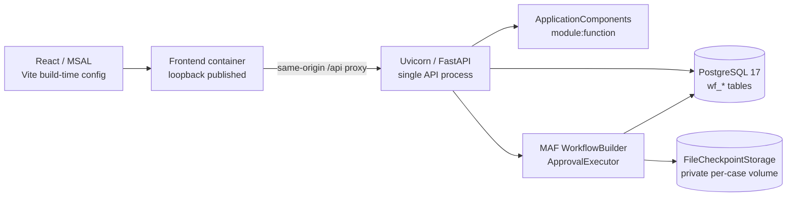

# Technology stack

This is the checked-in local-prototype baseline. Python dependencies are
locked with artifact hashes; versions below are source configuration, not a
claim about a deployed environment.

## Runtime and dependencies

| Area | Current choice | Rationale and alternatives |
| --- | --- | --- |
| Python | Python 3.12; `python:3.12-slim` backend image | Matches the source and GitHub Actions runtime. A different Python minor requires package and CI verification. |
| Agent workflow | `agent-framework-core==1.26.0` | Uses MAF `WorkflowBuilder`, `Executor`, `WorkflowContext`, and `CheckpointStorage` natively. Reusable typed model, agent, prompt, tool and executor patterns are tracked in [#35](https://github.com/ppenumatsa1/agent-blueprints/issues/35). LangGraph or an SDK harness would be a separate blueprint, not a hidden runtime switch. |
| API | FastAPI `0.162.7`, Uvicorn `0.54.0` | Typed HTTP boundary, dependency-based bearer auth, and an ASGI server. |
| Observability | OpenTelemetry SDK `1.45.2`, Azure Monitor exporter `1.0.0b59` | Manual traces and metrics, explicit Azure export; local mode exports nothing. Hosted ingestion remains unverified ([#26](https://github.com/ppenumatsa1/agent-blueprints/issues/26)). |
| Persistence | Local PostgreSQL `17-alpine`, Psycopg binary `3.3.9`; staged Azure PostgreSQL 16 | Relational transactions and uniqueness constraints support the decision/action ledger; MAF file checkpoints remain separate. The major-version mismatch and managed-service operations remain open ([#24](https://github.com/ppenumatsa1/agent-blueprints/issues/24)). |
| Schema evolution | Alembic `1.16.5`, SQLAlchemy `2.1.8`, revision manifests | Explicit schema-owner migration; runtime validates without schema creation. Local PostgreSQL 16.15 and 17.12 are tested; managed backup/restore and target compatibility remain unverified ([#24](https://github.com/ppenumatsa1/agent-blueprints/issues/24)). |
| Identity | MSAL `1.39.0`, PyJWT crypto `2.15.1` | MSAL is used in the browser; the API verifies Entra v2 access tokens, scopes, roles, and record access. Test identities are isolated to tests. |
| API models | Pydantic provided by the pinned FastAPI graph | Request/response parsing rejects extra fields. A separate direct version pin is not currently declared. |
| Frontend | React/React DOM `19.3.1`, TypeScript `7.0.2`, Vite `8.3.8` | Component UI, static typing, and a production build; a different UI framework would need its own client contract and tests. |
| Browser auth | `@azure/msal-browser` `5.29.1`, `@azure/msal-react` `5.8.2` | Browser obtains scoped delegated access tokens. Secrets and OBO credentials remain server-side. |
| Frontend tests | Vitest `5.1.0`, Testing Library, jsdom `31.0.1`, axe-core `4.14.0` | Exercise UI and API client behavior. Automated accessibility checks do not assess color contrast. |
| Developer tooling | uv `0.9.26`, Ruff `0.14.13`, Node 22, VS Code tasks | Locked backend installs and consistent lint/format checks; editor debugging remains unverified ([#23](https://github.com/ppenumatsa1/agent-blueprints/issues/23)). |
| Packaging | Docker Compose; sibling `backend` and `frontend` build contexts | The runnable topology is local and loopback-bound. Optional ACA descriptors are staged only ([#18](https://github.com/ppenumatsa1/agent-blueprints/issues/18)); ACA and Foundry hosting are not verified runtimes ([#31](https://github.com/ppenumatsa1/agent-blueprints/issues/31), [#19](https://github.com/ppenumatsa1/agent-blueprints/issues/19)). |
| Infrastructure | Local Bicep modules, azd service descriptors, Python static validator | Bicep 0.49.2 compiled and linted locally without Azure credentials. The application graph is not wired ([#18](https://github.com/ppenumatsa1/agent-blueprints/issues/18)); deployment needs separate authorization ([#28](https://github.com/ppenumatsa1/agent-blueprints/issues/28)). |
| Staged cloud resources | Foundry account/project, private PostgreSQL, Log Analytics/Application Insights, managed identities; optional model, project-wide consumer grant, registry and API/UI Container Apps | Development-oriented, restrictive defaults are not free or production-ready. Network paths and live service behavior remain unverified ([#18](https://github.com/ppenumatsa1/agent-blueprints/issues/18), [#24](https://github.com/ppenumatsa1/agent-blueprints/issues/24), [#28](https://github.com/ppenumatsa1/agent-blueprints/issues/28)). |

## Runtime dependency and process topology

The diagram is the checked-in local shape, not an Azure hosting diagram. The
MAF package supplies the workflow protocol and file checkpoint implementation;
FastAPI does not turn the graph into a separate orchestration engine. Compose
starts PostgreSQL first, waits for its health check, then the API; the web
service waits for the API health check. Only the web port is published, bound
to `127.0.0.1`.

The exact Python requirements are in
[`backend/pyproject.toml`](../../backend/pyproject.toml), with the resolved
graph and hashes in [`backend/uv.lock`](../../backend/uv.lock); the
approved `agent-framework-core==1.26.0` wheel digest is recorded in
[`backend/agent-framework-core.sha256`](../../backend/agent-framework-core.sha256)
and checked against both the downloaded wheel and its canonical lock entry by
[`backend/scripts/verify_framework_supply_chain.py`](../../backend/scripts/verify_framework_supply_chain.py).
The one `uv.lock` remains the dependency graph used for installation.
frontend's direct dependency manifest and lock are
[`frontend/package.json`](../../frontend/package.json) and
[`frontend/package-lock.json`](../../frontend/package-lock.json).
Compose declares the PostgreSQL image in
[`compose.yaml`](../../compose.yaml). The source repository's
`.github/workflows/ci.yml` pins GitHub Actions revisions; that CI file is
not copied into a generated project.

The staged server's API/version evidence, local 16.15 migration result and
remaining 16/17 mismatch are recorded in the
[infrastructure guide](../../infra/README.md#open-postgresql-version-gap).
Neither local tests nor Bicep compilation establish Azure compatibility.

## State and identity choices

- **MAF checkpoint:** `FileCheckpointStorage` in a private local directory,
  scoped by case. Single-host only.
- **Business state:** PostgreSQL stores cases, decisions, audit events, and
  action ledger. A per-case PostgreSQL advisory lock coordinates workflow and
  database transitions; it does not make file and SQL writes atomic.
- **Identity:** Entra v2 delegated access tokens for interactive API calls.
  A synthetic principal is a test dependency, never an interactive fallback.
- **Application extension:** `ApplicationComponents` provides rules, policy,
  action, optional initialization, and a native workflow factory. The
  blueprint does not own application-specific business behavior.

## Configuration contract

Compose reads values from the process environment; there is no checked-in
`.env` file and no secret-bearing configuration template. The sample
[README setup](../../README.md#local-stack) is the runnable entry point.

| Variable | Consumer and effect | Classification / validation |
| --- | --- | --- |
| `ENTRA_TENANT_ID`, `ENTRA_API_CLIENT_ID` | API JWT issuer/tenant and audience | Required UUIDs; server configuration |
| `ENTRA_SPA_CLIENT_ID`, `ENTRA_API_APP_ID_URI` | Vite/MSAL tenant app and three delegated scope names | Required public SPA configuration, embedded at frontend build time |
| `DATABASE_URL` | `PostgresStore` connection | Required PostgreSQL URL; server secret; Compose constructs it using `POSTGRES_PASSWORD` |
| `POSTGRES_PASSWORD` | PostgreSQL initial account and API URL | Required; secret; URL-safe; changing it does not rotate an existing volume's credentials |
| `CHECKPOINT_ROOT` | `LocalWorkflowHost` private file storage | Required absolute container path in Compose; single-host persistence |
| `WORKFLOW_HOST` | Settings host selection | Defaults to `local`; any other value is rejected |
| `BLUEPRINT_APPLICATION` | `app.main` loads an `ApplicationComponents` factory | Required `module:function`; Compose example selects `examples.synthetic_application:build_application` |
| `CORS_ORIGINS` | Optional FastAPI CORS middleware | Explicit comma-separated origins only; no wildcard; plain HTTP allowed only for loopback |
| `OBO_ENABLED`, `OBO_ALLOWED_SCOPES`, `ENTRA_API_CLIENT_SECRET` | Optional server-side MSAL OBO exchange | Off by default; enabling requires secret and explicitly allowlisted resource scopes; never a Vite variable |
| `BLUEPRINT_PORT` | Host loopback port for web container | Optional; defaults to `8080` |
| `NPM_REGISTRY`, `PYTHON_PACKAGE_INDEX` | Frontend/backend image build only | Optional approved package mirror; do not put credentials in registry URLs |

`Settings.from_environment()` parses backend settings during startup.
`app/main.py` loads the selected application factory and calls
`composition.create_app()`, which wires the store, Entra verifier, local host,
service, and `lifecycle.create_lifespan()`. `api/app.py` assembles FastAPI,
middleware, handlers, and routers; the lifespan validates the expected
migration revision without DDL, invokes application initialization, and
attempts recovery before serving.
Frontend variables are Vite build arguments, not runtime secrets. See
[setup](../setup.md) for the full environment workflow and
[deployment flow](deployment-flow.md) for commands and limits.

## Dependency and alternative status

The backend image exports the canonical lock and installs with artifact-hash
verification. Before installation, the supply-chain guard rejects the
compromised `agent-framework` umbrella distribution and verifies the approved
core wheel digest also present in `uv.lock`; `uv` remains the sole dependency
resolver and installer.
Foundry host integration and live managed identity binding remain planned.
Staged Bicep and azd files do not establish a deployment or verified host
integration. The current local image uses tags rather than
immutable image digests, so supply-chain hardening is still an acceptance
concern. See [deployment flow](deployment-flow.md) and
the source repository's `docs/engineering-standards.md`.

The **open** developer-tooling workstream is PR
[#13](https://github.com/ppenumatsa1/agent-blueprints/pull/13). The integrated
branch records head `543b137a432ca054920d629b943fc42a729df676` and hosted run
[44937692067](https://github.com/ppenumatsa1/agent-blueprints/actions/runs/44937692067),
which passed five checks for that exact revision, not this combined revision.
Earlier owner-reported PR #13 head `b78634b3b746c7adbf5f8500e4b7023c96c67963`
retained uv/lock-based tooling but lacked the Foundry Responses hosting
dependency; run
[44928260607](https://github.com/ppenumatsa1/agent-blueprints/actions/runs/44928260607)
passed five checks for the earlier exact head
`e1d953662e615e547fa641ad0831907c363318e3` only. Windows and Linux Compose
were reported using an approved package mirror after public TLS failures.
Interactive debugging was not exercised because VS Code was in Restricted
Mode, and one owner environment lacked `uv`; macOS and those environment
checks remain unverified. Adding the documented prerelease hosting package
requires separate dependency/lock coordination.

The migration workstream preserves the guarded Alembic adoption design:
validate the exact legacy baseline manifest and absence of later-revision
tables before stamping, while fresh databases run revision `0001` and
validation never stamps. The owner reports 48 source and 48 generated tests
on PostgreSQL 16.15 and 17.12 for commit `897aae8`; its five-job run
[44944613749](https://github.com/ppenumatsa1/agent-blueprints/actions/runs/44944613749)
used old base `d0e1727` and is not final combined CI. The integration branch
contains follow-up commit `ce86252324dca041fd5430602a3fc2c28a355274`, reported
to pass 12 focused migration regressions on isolated PostgreSQL 17 and Ruff
0.14.13 checks. This focused local evidence does not establish the whole
combined revision or Azure compatibility. See the
[journal](issues-changes-fixes.md).

## Official references

- [Microsoft Agent Framework](https://learn.microsoft.com/en-us/agent-framework/)
- [FastAPI documentation](https://fastapi.tiangolo.com/)
- [Microsoft identity platform and MSAL](https://learn.microsoft.com/en-us/entra/identity-platform/msal-overview)
- [PostgreSQL documentation](https://www.postgresql.org/docs/)
- [Docker Compose documentation](https://docs.docker.com/compose/)
- [React documentation](https://react.dev/learn)
- [Vite documentation](https://vite.dev/guide/)
- [uv documentation](https://docs.astral.sh/uv/)
- [Ruff documentation](https://docs.astral.sh/ruff/)

These references describe upstream products, not proof that an unimplemented
hosting or telemetry integration works.
