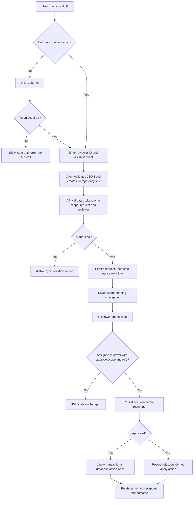
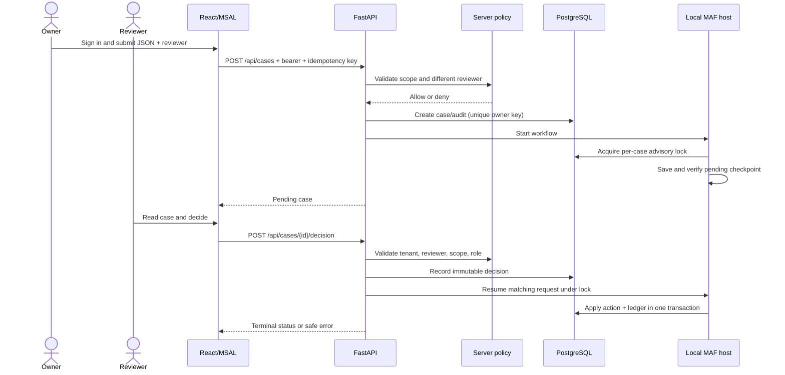

# User flows

## Submit, review, and complete

The current UI supports one request at a time and requires an existing
authorized Entra configuration. CI uses synthetic identities and does not
perform interactive sign-in.
Before users can reach the API, an operator applies reviewed business
migrations; runtime startup rejects an outdated or drifted schema.

## Request and approval sequence

## Failure and retry behavior

- **Token acquisition or API authentication failure:** show a safe message;
  do not call the protected operation without a token.
- **Unauthorized record read/decision:** the API returns 403; browser-side
  hiding is not authorization. The owner and assigned reviewer restrictions
  are enforced by `CaseAccessPolicy`.
- **Network error during submission:** the client retains the idempotency key
  for the same request fingerprint. Reopening/retrying a different payload
  must not reuse it. Check the record before repeating an ambiguous action.
- **Decision conflict:** the API returns 409. A different decision or actor
  cannot replace an already persisted decision.
- **Action/checkpoint/recovery failure:** the API returns an explicit failure
  class; logs omit tokens and payloads. Do not delete checkpoints or blindly
  repeat an external side effect.
- **Telemetry export failure:** fixed sanitized failure signals are logged;
  the workflow result is unaffected. Missing Azure configuration instead
  stops startup. Neither signal proves cloud delivery.
- **Process crash:** startup recovery reconciles SQL state with local MAF
  checkpoints. The tested worker-kill windows cover decision persistence and
  database-action commit, not host failover or external systems.

## Implementation references

The browser journey is implemented by
[`authenticated-app.tsx`](../../frontend/src/authenticated-app.tsx),
[`api.ts`](../../frontend/src/api.ts), and
[`workspace.tsx`](../../frontend/src/workspace.tsx). API policy and transitions
are in `backend/app/api.py`, `backend/app/domain/policy.py`,
`backend/app/usecases/service.py`, and `backend/app/infrastructure/store.py`.
Tests under `backend/tests/test_security.py` and `backend/tests/test_core.py`
cover automated authorization and recovery. Live Entra login and role
assignment remain unverified.
