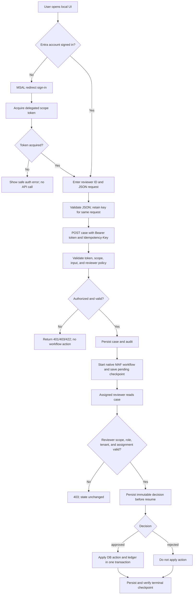

# User flows

## Submit, review, and complete

The current UI supports one request at a time and requires existing,
authorized Entra SPA/API registrations. CI uses synthetic identities and does
not perform interactive sign-in. These are local workflow journeys; no
Foundry-hosted or cloud deployment path is implemented.



## Request and approval sequence

```mermaid
sequenceDiagram
    actor Owner
    actor Reviewer
    participant Browser as React/MSAL
    participant API as FastAPI case routes
    participant Entra as Microsoft Entra ID
    participant Identity as EntraIdentity
    participant Policy as CaseAccessPolicy
    participant Service as WorkflowService
    participant DB as PostgreSQL
    participant Host as Local MAF host

    Owner->>Browser: Sign in
    Browser->>Entra: Redirect and request workflow.write
    Entra-->>Browser: Delegated access token
    Owner->>Browser: Submit JSON + reviewer
    Browser->>API: POST /api/cases + Bearer + Idempotency-Key
    API->>Identity: Validate signature, issuer, audience, tenant, time
    Identity-->>Policy: Validated principal (subject, scopes, roles)
    Policy->>Policy: Require workflow.write; reviewer differs from owner
    API->>Service: submit(principal, reviewer, payload, key)
    Service->>DB: Create case/audit or resolve identical idempotent retry
    Service->>Host: Start workflow
    Host->>DB: Acquire per-case advisory lock
    Host->>Host: Run ApprovalExecutor.request_approval
    Host->>Host: Save and verify pending request checkpoint
    API-->>Browser: Pending case
    Reviewer->>Browser: Read case and decide
    Browser->>API: POST /api/cases/{id}/decision
    API->>Identity: Validate approver access token
    Identity-->>Policy: Validated reviewer principal
    Policy->>Policy: Require workflow.approve + Workflow.Approver<br/>same tenant, assigned reviewer, not owner
    API->>Service: decide(principal, case_id, decision)
    Service->>DB: Record immutable decision before resume
    Service->>Host: Resume matching pending request under lock
    Host->>DB: Apply action + ledger in one transaction
    Host->>Host: Verify terminal checkpoint and outcome
    API-->>Browser: Terminal status or safe error
```

## Identity and operation authority

| Browser operation | Delegated API scope | Server policy |
| --- | --- | --- |
| `GET /api/cases/{case_id}` | `<API app URI>/workflow.read` | Same tenant; caller is case owner or assigned reviewer |
| `POST /api/cases` | `<API app URI>/workflow.write` | Valid reviewer UUID; reviewer cannot be the submitter |
| `POST /api/cases/{case_id}/decision` | `<API app URI>/workflow.approve` | Same tenant; caller is assigned reviewer, not owner, and has `Workflow.Approver` role |

`EntraIdentity` requires an RS256 signature and validates configured v2
issuer, API audience, tenant, subject/object identifiers, scopes, token
version, and time claims. Missing or invalid tokens return `401`; a valid
principal lacking scope, role, or case assignment returns `403`. The API
returns a request-scoped `X-Correlation-ID`; the case's `correlation_id` is
the case UUID. These IDs aid support but do not grant access. Live sign-in,
role assignment, and optional OBO are not verified by synthetic test
identities.

## Failure and retry behavior

- **Token acquisition or API authentication failure:** show a safe message;
  do not call the protected operation without a token. The frontend stores
  MSAL account state in `sessionStorage` and acquires tokens silently for the
  requested operation scope before sending a request.
- **Signing-key lookup unavailable:** the token verifier fails closed and the
  API returns `503`; it does not accept an unverified token or replace the
  unavailable identity service with a synthetic principal.
- **Unauthorized record read/decision:** the API returns 403; browser-side
  hiding is not authorization. The owner and assigned reviewer restrictions
  are enforced by `CaseAccessPolicy`.
- **Network error during submission:** the browser retains the idempotency key
  in component memory for the same reviewer/payload fingerprint. Editing
  either input generates a new key; reload does not preserve it. Check the
  case before repeating an ambiguous operation.
- **Decision conflict:** a repeated or different decision after the first
  immutable decision returns 409; a caller who is not the assigned reviewer
  is denied with 403 before a decision can be recorded.
- **Action/checkpoint/recovery failure:** the API returns an explicit failure
  status (`503` for unavailable action/checkpoint infrastructure); the public
  body remains generic and logs omit tokens and payloads. Do not delete
  checkpoints or blindly repeat an external side effect.
- **Process crash:** startup recovery reconciles SQL state with local MAF
  checkpoints. The tested worker-kill windows cover decision persistence and
  database-action commit, not host failover or external systems.
- **Malformed input:** FastAPI/Pydantic rejects extra fields, invalid UUIDs,
  unsupported decision values, and malformed JSON as `422`. A missing
  record returns `404`; same-key/different-request or state conflicts return
  `409`.

## Implementation references

The browser journey is implemented by
[`authenticated-app.tsx`](../../frontend/src/authenticated-app.tsx),
[`api.ts`](../../frontend/src/api.ts), and
[`workspace.tsx`](../../frontend/src/workspace.tsx). HTTP handlers and identity
dependencies are in `backend/app/api/routes/cases.py` and
`backend/app/api/dependencies.py`; the API is assembled in
`backend/app/api/app.py` and composed in `backend/app/composition.py`.
Authorization and transitions are in `backend/app/domain/policy.py` and
`backend/app/usecases/service.py`, persistence in
`backend/app/infrastructure/store.py`, and startup recovery in
`backend/app/lifecycle.py`.
Tests under `backend/tests/test_security.py` and `backend/tests/test_core.py`
cover automated authorization and recovery. Live Entra login and role
assignment remain unverified.

`Settings` rejects wildcard CORS and non-loopback HTTP origins.
`compose.yaml` uses the web container's same-origin `/api` proxy, binds the
web port to loopback, and does not publish API or database ports. Optional
OBO is disabled by default; enabling it requires a server-side secret and
explicit resource-qualified scopes, and the synthetic request flow does not
invoke it.
