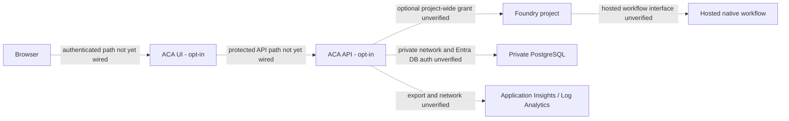

# Foundry-first infrastructure: offline preparation

These Bicep modules and `azure.yaml` are **staged infrastructure**, not a
deployable end-to-end application or authorization to create resources.
Nothing in this directory has been provisioned or tested against Azure.
The host adapter, API-to-agent protocol, identity propagation, approvals,
managed checkpoints and recovery remain unverified. The Foundry hosted-agent
service is deliberately absent from `azure.yaml` until its actual source
root, entrypoint and contract are agreed. The two declared Container Apps
services are the adjacent API and web UI, **not** workflow runtimes.



The IaC resources do not establish the dashed runtime connections. Foundry's
public data-plane access and telemetry public ingestion/query are disabled,
with **no** private endpoints or Azure Monitor Private Link Scope in this
milestone. Ordinary client data-plane connectivity is not provided. The
current local API only accepts `WORKFLOW_HOST=local` and does not implement a
managed-identity PostgreSQL token flow; do not run it as the intended cloud
API. The current nginx proxy targets `api:8000`, whereas ACA HTTP ingress uses
its own TLS endpoint, and the SPA needs its public Entra values at build
time. These are integration blockers, not configuration defaults to guess.
The configured internal ingress is reachable directly only by other apps in
the same Container Apps environment, not by a browser elsewhere on the VNet;
no environment-level route is supplied. See
[Container Apps ingress](https://learn.microsoft.com/en-us/azure/container-apps/ingress-overview).

## What the modules describe

| Module | Behavior and limitations |
| --- | --- |
| `network.bicep` | One parameterized RFC1918 VNet; separate delegated ACA and PostgreSQL subnets; PostgreSQL private DNS zone and link. No Foundry/monitor private endpoints, NSGs, egress filtering or production network controls. |
| `foundry.bicep` | Foundry account and project with system identities, key authentication disabled, public access disabled and deny-by-default ACLs. A model deployment is opt-in and requires a reviewed model, version, SKU, capacity, region and quota. |
| `postgres.bicep` | Private Flexible Server and database, Entra-only auth, an explicitly supplied administrator, TLS required, 7-day backup and development-sized burstable default. No password administrator, firewall allow-all, database application principal or token-refresh implementation is created. |
| `observability.bicep` | Workspace-based Application Insights and Log Analytics, 30-day default retention and 1 GB/day ingestion cap. Public ingestion/query and Insights local authentication are disabled; no private connectivity or exporter role is configured. The cap can discard telemetry. |
| `identities.bicep` | Separate API and UI user-assigned managed identities. The project system identity receives Foundry User at account scope per Foundry guidance. A project-wide Foundry Agent Consumer grant to the API is opt-in and disabled by default; its scope covers all agents in that project. Actual role requirements need live review. |
| `registry.bicep` | Optional Basic registry. It is internet-reachable when selected, but disables admin credentials and anonymous pulls; the two workload identities get only registry-scoped AcrPull. Private registry networking and hosted-agent image-pull permissions are not implemented. |
| `container-apps.bicep` | Optional, separate UI and API in an internal-only workload-profile environment, with HTTPS-only internal ingress and scale-to-zero. The API's Entra platform-auth configuration specifies 401 except for `/healthz`; actual behavior is unverified. The API must independently enforce authentication, scopes, roles and record authorization. Caller-supplied images and configuration are required. |

`createRegistry`, `createContainerApps`, `deployModel`, and
`grantProjectAgentConsumer` default to false.
Creating the template's other resources would still incur cost, especially
PostgreSQL; the defaults are development-oriented, not free and not a
production availability, backup, security or cost claim. Availability,
retention, networking and pricing require a separate regional review.

Container Apps platform authentication is a separate child resource and can
fail to configure after an app is created. It is not a substitute for
fail-closed application authentication and authorization, even on an internal
endpoint. Do not select an image that relies on platform authentication alone.

The optional project-wide consumer grant is not the least-privilege final
host binding. Once an actual hosted agent and its trust boundary are verified,
prefer an appropriately scoped agent-specific grant and review the project's
account-scoped system-identity role. An agent-scoped grant is not exclusive:
inherited project/account assignments and any other enabled authentication or
privileged development paths may also allow access. No endpoint caller
restriction or authenticated principal propagation has been verified.
Any future forwarded workload token also requires reviewed evidence for
gateway retention, stripping, replay and background recovery; no forwarding
or token policy is configured here.
See [Foundry RBAC](https://learn.microsoft.com/en-us/azure/foundry/concepts/rbac-foundry)
and [hosted-agent permissions](https://learn.microsoft.com/en-us/azure/foundry/agents/concepts/hosted-agent-permissions).

The deployment principal needs permission to create the requested resources
and scoped role assignments. Runtime roles must not be used as provisioning
permissions. `apiEnvironment` and `webEnvironment` are **non-secret** only.
For application secrets, `apiSecretReferences` accepts entries with `name`,
`keyVaultUrl`, and `environmentName`; an existing vault and a separately
authorized Key Vault Secrets User assignment for the API identity are
prerequisites. Neither the vault nor that assignment is provisioned here.
Never put credentials, tokens, passwords or connection strings in parameter
files, environment examples, outputs, images or logs. Current backend/DB
authentication still needs a compatible implementation; a secret reference
does not make the Entra-only database compatible.

`main.parameters.json` binds only required non-secret values to azd
environment variables. `environments/azd.env.example` and the two
`.bicepparam` examples contain synthetic placeholders; they are not usable
Azure configuration and do not select a subscription, region or tenant.
The `.bicepparam` files are compiler examples, not automatically selected
by azd. Optional Bicep parameters require explicit, reviewed native-typed
parameter values; model and image inputs must not be invented.

For later integration, the graph proposes non-secret discovery outputs
`AZURE_AI_PROJECT_ENDPOINT`, `AZURE_AI_MODEL_DEPLOYMENT_NAME`,
`AZURE_API_IDENTITY_CLIENT_ID`, `AZURE_POSTGRESQL_HOST`, and
`AZURE_POSTGRESQL_DATABASE`. These are outputs, not environment injection,
an agent service contract, or proof that the endpoint, identity, network,
database or workflow can be used together. The hosted service root,
entrypoint, authentication and continuation bindings must be agreed and
verified before adding them to `azure.yaml`.

## Credential-free checks

From the blueprint root, or from a generated project's own root:

```text
python infra/validate.py --check-compiler
python infra/validate.py
python -m unittest discover -s infra/tests -v
```

Python 3.12 and Bicep 0.49.2 or newer are prerequisites. If `bicep` is not on `PATH`, the
checker also searches the Azure CLI's cached binary, or accepts an explicit
`BICEP_CLI` path. It does not install dependencies, use Azure credentials,
restore external modules or make network requests. CI installs a compiler
only when this prerequisite check fails. The checker compiles and lints the
local Bicep graph, compiles both parameter examples, checks the committed
network examples, and validates local service paths and required azd
bindings. Tests additionally inspect compiled ARM security properties and
exercise negative configuration cases. These checks do **not** evaluate
arbitrary future operator-supplied parameters or prove Azure compatibility.

The modules use local Bicep resources rather than external registry modules,
so offline validation and generated copies do not depend on AVM downloads.
This is not a claim that the modules are Azure Verified Modules. The compiler
and linter cannot establish quota, SKU availability, role propagation, live
authentication, private DNS or network reachability, secure image pulls,
telemetry delivery, hosted-agent behavior, checkpoints or business recovery.

Before any deployment, integrate and test the actual Foundry host contract,
database authentication, reverse proxy and UI build; review network, roles,
secrets, logging and image provenance; then prepare the required inventory,
cost estimate and approval. A future live test must record real outcomes,
including failures. No Azure resource mutation is authorized by these files.
